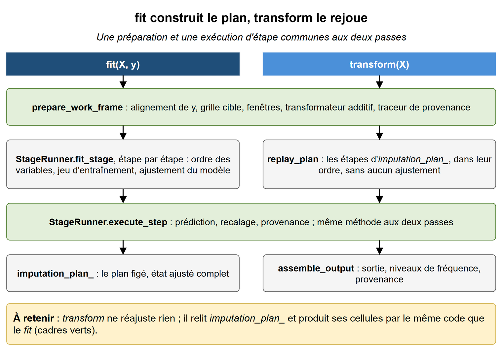

# Architecture interne de `HighFrequencyImputer`

Cette page décrit l'organisation du code de l'imputeur, pour qui veut le lire ou le modifier. Son
fonctionnement et son paramétrage sont présentés dans le
[concept](../../concepts/mixed_frequency_imputation.md).

`HighFrequencyImputer` est un orchestrateur : la classe valide les paramètres, publie les attributs
ajustés et enchaîne les phases ; chaque phase vit dans un module de
`tsforecast/imputation/_engine/`. Le `fit` et le `transform` partagent la **même préparation** et la
**même exécution d'étape** : le `fit` construit chaque étape puis l'exécute, le `transform` rejoue le
plan figé (`ImputationPlan`).

Le contexte d'exécution (`_RunContext`) n'est jamais stocké sur l'imputeur : chaque passe reçoit son
matérialiseur, ses registres, son calculateur de fenêtre, son traceur de provenance et ses
avertissements en attente. Un `transform` ne lit ni n'altère aucun état d'exécution du `fit`.

## Moteur (`_engine/`)

| Module | Rôle |
|--------|------|
| [`params`](engine/params.md) | validateurs purs des paramètres du constructeur |
| [`frequency_layout`](engine/frequency_layout.md) | `FrequencyLayout` figé et `plan_frequencies` : fréquence de chaque couple (entité, colonne), catégories de variables, progression des étapes |
| [`preparation`](engine/preparation.md) | `prepare_work_frame` : phases communes au `fit` et au `transform` |
| [`run_context`](engine/run_context.md) | `FittedComponents` (configurés au `fit`, relus par toute passe) et `_RunContext` (état d'une passe) |
| [`grids`](engine/grids.md) | grilles de prédiction et masques de fenêtre d'une étape |
| [`row_scaling`](engine/row_scaling.md) | `RowScaler` : diviseurs par ligne des jeux d'entraînement mutualisés |
| [`stage_runner`](engine/stage_runner.md) | `StageRunner` : ajustement d'une étape (`fit_stage`) et exécution d'une étape du plan (`execute_step`) |
| [`replay`](engine/replay.md) | rejeu du plan, contrôles du `transform`, entités nées au `transform` |
| [`output`](engine/output.md) | assemblage de la sortie et gestes de l'inversion |
| [`warnings`](engine/warnings.md) | `WarningAccumulator` : un avertissement par famille et par passe |

## Composants (`_components/`)

| Composant | Rôle |
|-----------|------|
| [`ImputationPlan`, `ImputationStep`](imputation_plan.md) | état ajusté complet, une étape par (fréquence, variable) |
| [`ImputationProvenanceTracker`, `ProvenanceType`](provenance.md) | suivi de provenance et primitives de souillure |
| [`CovariateMaterializer`](covariate_materializer.md) | produit `X_train` / `X_pred` ; la prédiction ne dispose jamais de moins d'information que l'entraînement |
| [`StageScaler`](stage_scaler.md) | met les deux côtés du modèle à la même échelle de fréquence |
| [`AggregationConstraint`](aggregation_constraint.md) | recale les sous-périodes sur le total observé |
| [`VariableOrderer`](variable_orderer.md) | ordonne les variables (`'frequency'` ou `'cv'`), expose `scores_` |
| [`TrainingSetBuilder`](training_set_builder.md) | jeu d'entraînement mutualisé entre entités d'un panel |
| [`ImputationWindowCalculator`](imputation_window.md) | fenêtres de prédiction et d'entraînement |
| [`TargetFrequencyValidator`](target_frequency_validator.md) | cohérence fréquence cible ↔ fréquences détectées |

`_engine/` et `_components/` sont des détails d'implémentation : l'API publique est celle de la
classe et des types réexportés par `tsforecast.imputation`. `FrequencyAligner` et `IndexRegularizer`
(`tsforecast.utils.frequency`) sont des outils autonomes que l'imputeur n'utilise pas.
