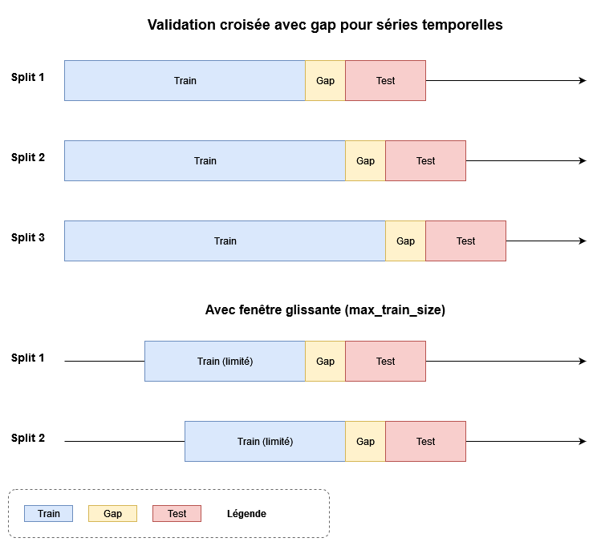

# Cross-validation temporelle

## Le problème

La validation croisée classique (`KFold`) mélange les observations au hasard. Sur
une série temporelle, cela revient à entraîner un modèle sur le futur pour
prédire le passé : les scores obtenus sont optimistes et ne disent rien de la
performance réelle en production.

`tsforecast.crossvals` fournit des *splitters* qui respectent l'ordre temporel :
dans le cas `out-of-sample`, l'entraînement précède strictement le test, et un
intervalle (`gap`) peut être imposé entre les deux pour reproduire un délai du à l'horizon de prévision ou au délai de publication de la variable que l'on cherche à prédire.

## Deux familles

| Famille | Le test est… | Usage |
|---------|--------------|-------|
| **Out-of-sample** (`OutOfSampleSplit`, `TSOutOfSampleSplit`, `PanelOutOfSampleSplit`) | exclu de l'entraînement | estimer la performance de prévision réelle |
| **In-sample** (`InSampleSplit`, `TSInSampleSplit`, `PanelInSampleSplit`) | inclus dans l'entraînement | évaluer un ajustement historique (backcast, *nowcasting* révisé) |

Chaque famille se décline pour :

- une **série temporelle** unique — un index trié (le plus souvent un
  `DatetimeIndex` ou un `PeriodIndex`), ou un tableau pris dans l'ordre de ses
  lignes ; les splitters `TS*` refusent un `MultiIndex` ;
- un **panel** — `MultiIndex (entité..., date)`, avec deux variantes :
    - `Panel*Split` : un découpage global, les mêmes dates de test pour toutes
      les entités, chaque pli contenant toutes les entités. Un modèle qui
      mutualise les entités n'apprend ainsi jamais sur la période de test. Une
      entité qui ne porte pas les dates de test d'un pli (entité qui finit plus
      tôt) n'y est pas testée, mais apprend sur ses dates antérieures (avec
      `gap` et la fenêtre) ; un avertissement la signale ;
    - `Panel*SplitPerEntity` : un découpage propre à chaque entité, sur ses
      propres dates (plis par défaut : ses dernières dates), un pli par entité
      et par découpage. Une entité trop courte pour les plis par défaut, ou qui
      ne porte pas une date demandée, ne reçoit pas de pli (avertissement).

Le découpage se fait par position, sur les données triées par date (par
entité puis date pour un panel) : un index de dates, de périodes ou de nombres
non trié est trié avec un avertissement ; un index de libellés (chaînes) doit
déjà être trié, son ordre alphabétique n'étant pas chronologique
(`'01/31/2024'` précède `'12/31/2023'`) : le convertir avec `pd.to_datetime` ;
une date répétée (un couple entité-date répété pour un panel) est refusée.
Pour un panel, l'entité est formée de tous les niveaux de l'index sauf le
dernier, qui porte la date.

## Paramètres clés

- `n_splits` : nombre de plis hors échantillon (défaut 5) ; en échantillon, il
  ne fixe que la taille de test par défaut, le découpage ayant toujours un seul
  pli ;
- `test_size` : taille de chaque ensemble de test ;
- `gap` (hors échantillon seulement) : nombre de périodes ignorées entre
  entraînement et test — c'est le levier anti-fuite. Un modèle qui prédit à
  horizon *h* doit être évalué avec `gap = h`. Une configuration qui laisserait
  un pli sans données d'entraînement est refusée ;
- `max_train_size` : plafond de la fenêtre d'entraînement (fenêtre glissante
  plutôt qu'extensible) ;
- `test_indices` : débuts de test explicites, au lieu des dernières portions :
  positions entières (jamais des booléens), dates (chaînes, `Timestamp`,
  `datetime`, `date`, `numpy.datetime64`, `Period`, `DatetimeIndex`) ou, pour
  un panel, couples `(entité, date)`. Une date vaut pour toutes les entités ;
  une position ou un couple ouvre un pli limité à son entité.



## Compatibilité scikit-learn

Les splitters implémentent `split(X, y=None, groups=None)` et `get_n_splits()`.
Comme pour sklearn, `get_n_splits` se calcule sur les paramètres seuls : le
nombre de `test_indices` s'il y en a, `n_splits` sinon, 1 en échantillon. Les
variantes `Panel*SplitPerEntity` font exception : leur nombre de plis dépend des
entités et de leurs dates, `get_n_splits(X)` exige donc les données (comme
`LeaveOneGroupOut` exige `groups`) et compte exactement les plis produits ;
`GridSearchCV` les lui transmet. Ils s'utilisent donc directement partout où
sklearn attend un `cv` :

```python
from sklearn.model_selection import cross_validate, GridSearchCV
from tsforecast.crossvals import TSOutOfSampleSplit

cv = TSOutOfSampleSplit(n_splits=5, test_size=6, gap=1)
cross_validate(estimator, X, y, cv=cv, scoring="neg_root_mean_squared_error")
GridSearchCV(estimator, param_grid, cv=cv)
```

Pour un panel, passer `groups` (les identifiants d'entité) ou laisser le splitter
les extraire du `MultiIndex`.

## Pour aller plus loin

- Tutoriel : [Ensembles train/test rigoureux](../tutorials/pseudo_real_time_forecast.md)
- API : [OutOfSampleSplit](../api/crossvals/OutOfSampleSplit.md),
  [TSOutOfSampleSplit](../api/crossvals/TSOutOfSampleSplit.md),
  [PanelOutOfSampleSplit](../api/crossvals/PanelOutOfSampleSplit.md)
- Résumé des plis pour le tracking :
  [`split_summary`](../guides/mlflow_tracking.md)
