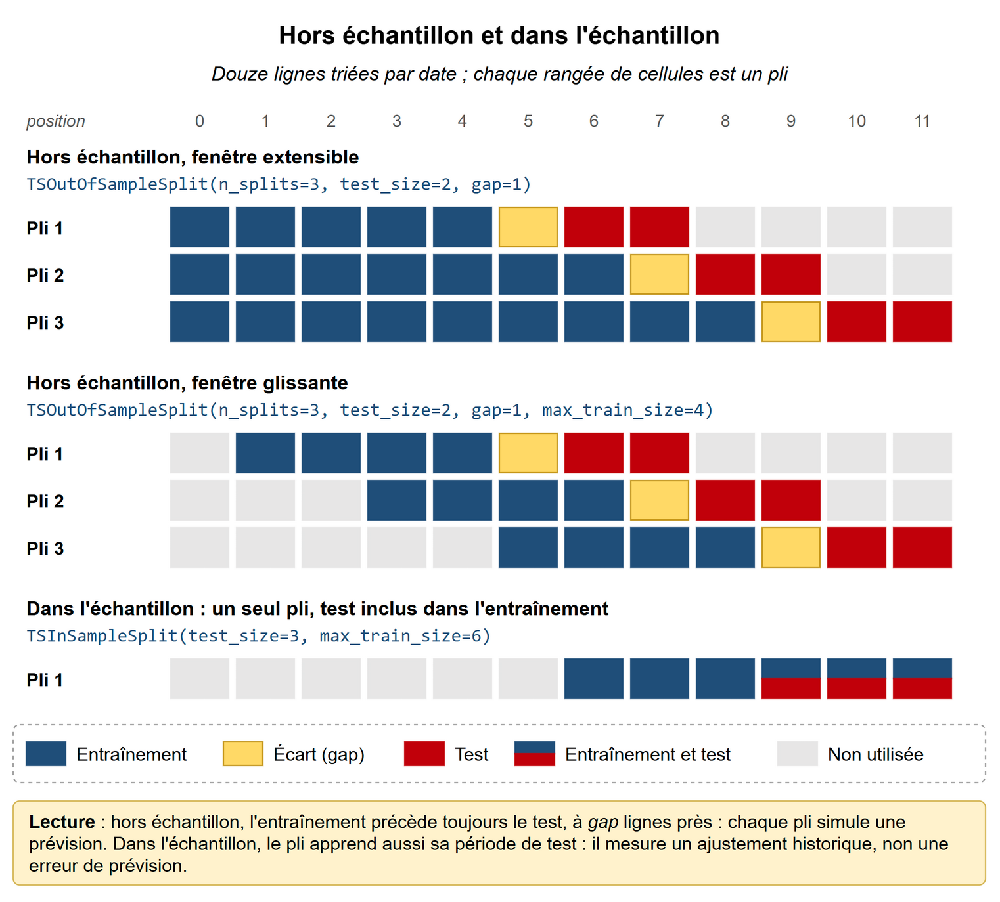

# Cross-validation temporelle

## Le problème

La validation croisée classique (`KFold`) répartit les observations au hasard entre entraînement et
test. Sur une série temporelle, le modèle apprend alors sur le futur pour prédire le passé : ses
scores sont optimistes et ne disent rien de sa performance en production.

`tsforecast.crossvals` fournit des *splitters* qui découpent les données **en respectant leur structure temporelle**.
Hors échantillon, chaque pli reproduit une prévision faite en temps réel : le modèle n'apprend que
sur des lignes antérieures au test, et un écart (`gap`) retire les lignes dont la cible n'était pas
encore connue à la date de la prévision.

## Deux familles

| Famille | Plis | Le test est… | Usage |
|---------|------|--------------|-------|
| **Hors échantillon** (`TSOutOfSampleSplit`, `PanelOutOfSampleSplit`, `PanelOutOfSampleSplitPerEntity`) | `n_splits`, ou un par élément de `test_indices` | exclu de l'entraînement, qui le précède | estimer l'erreur de prévision |
| **Dans l'échantillon** (`TSInSampleSplit`, `PanelInSampleSplit`, `PanelInSampleSplitPerEntity`) | un seul | inclus dans l'entraînement, qui s'arrête à la dernière ligne de test | mesurer un ajustement historique (rétropolation, estimation révisée d'une période passée) |



Un score dans l'échantillon est toujours plus favorable qu'un score hors échantillon sur la même
période : il ne sert pas à estimer une erreur de prévision.

## Séries temporelles et panels

Chaque famille se décline en trois classes :

- **`TS*Split`** : une **série temporelle** unique, indexée par des dates, des périodes ou des
  nombres, ou un tableau pris dans l'ordre de ses lignes. Un `MultiIndex` est refusé ;
- **`Panel*Split`** : un **panel**, indexé par un `MultiIndex` dont le dernier niveau porte la date
  et les autres l'entité. Les **mêmes dates de test** valent pour toutes les entités et un pli
  contient toutes les entités : un modèle apprend sur toutes les entités jusqu'à une date données et prédit pour toutes les entités ;
- **`Panel*SplitPerEntity`** : un panel dont chaque entité est découpée **sur ses propres dates**,
  avec un pli par entité et par découpage : un modèle est entrainée et évalué indépendamment sur chaque entité.

Sur un panel, `gap`, `test_size` et `max_train_size` se comptent en dates de chaque entité. La
différence entre les deux variantes n'apparaît que sur un panel **déséquilibré** :


Avec des dates communes, une entité qui ne porte pas la première date de test d'un pli n'y est pas
testée (un avertissement le signale) mais reste dans l'entraînement, sur ses dates antérieures au
test moins le `gap`. Une entité testée doit garder au moins une date d'entraînement, sinon le
découpage est refusé. La variante `PerEntity` écarte, avec un avertissement, une entité trop
courte pour un pli.

## Les règles du découpage

Le découpage se fait **par position**, sur les données triées par date (par entité puis par date
pour un panel) ; `split` renvoie les positions des lignes de `X` tel qu'il est passé.

- **Plis par défaut** (sans `test_indices`) : hors échantillon, `n_splits` blocs de test adjacents,
  le dernier se terminant à la dernière date, comme le `TimeSeriesSplit` de scikit-learn ; dans
  l'échantillon, un seul bloc, les `test_size` dernières lignes. Sur un panel, ce sont les
  dernières dates du panel (`Panel*Split`) ou de chaque entité (`PerEntity`).
- **`test_size`** : nombre de lignes (de dates par entité) de chaque test. Par défaut,
  `n_samples // (n_splits + 1)` pour une série, 1 sur un panel ou lorsque `test_indices` est précisé.
- **`gap`** (hors échantillon) : nombre de lignes retirées entre l'entraînement et le test. Pour un
  horizon `h` et une cible publiée `d` périodes après sa période, l'écart minimal sans fuite est
  `gap = h + d − 1` ; le [tutoriel](../tutorials/pseudo_real_time_forecast.md#3-choisir-le-gap)
  le justifie.
- **`max_train_size`** : plafond de l'entraînement, qui devient une **fenêtre glissante** au lieu
  d'une fenêtre extensible depuis la première date. Dans l'échantillon, la fenêtre couvre au moins
  toute la période de test.
- **`test_indices`** : débuts de test explicites, chacun ouvrant un pli hors échantillon de
  `test_size` lignes, coupé à la fin des données ou de l'entité. Un élément est une position
  entière, une date (chaîne, `Timestamp`, `datetime`, `date`, `numpy.datetime64`, `Period`) ou, pour
  un panel, un couple `(entité, date)`. Une date vaut pour toutes les entités qui la portent ; une
  position ou un couple ouvre un pli limité à son entité. Dans l'échantillon, plusieurs éléments
  désignent exactement leurs lignes et `test_size` n'est pas utilisé.

Un index de dates, de périodes ou de nombres non trié est trié avec un avertissement. Un index de
libellés (chaînes) doit déjà être trié, son ordre alphabétique n'étant pas chronologique
(`'02/2024'` précède `'12/2023'`). Il est préférable de le convertir avec `pd.to_datetime`. Une date répétée (un couple
entité-date répété pour un panel) est refusée, comme une configuration qui laisserait un pli sans
entraînement.

## Compatibilité scikit-learn

Les splitters implémentent `split(X, y=None, groups=None)` et `get_n_splits()`, et s'utilisent
partout où sklearn attend un `cv` :

```python
import numpy as np
import pandas as pd
from sklearn.linear_model import Ridge
from sklearn.model_selection import GridSearchCV, cross_validate
from tsforecast.crossvals import TSOutOfSampleSplit

dates = pd.date_range("2020-01-01", periods=60, freq="MS")
X = pd.DataFrame({"x": np.arange(60.0)}, index=dates)
y = 2 * X["x"] + 1

cv = TSOutOfSampleSplit(n_splits=5, test_size=6, gap=1)
cross_validate(Ridge(), X, y, cv=cv, scoring="neg_root_mean_squared_error")
GridSearchCV(Ridge(), {"alpha": [0.1, 1.0, 10.0]}, cv=cv).fit(X, y)
```

- **Nombre de plis** : comme pour sklearn, `get_n_splits()` se calcule sur les paramètres seuls
  (le nombre de `test_indices` s'il y en a, `n_splits` sinon, 1 dans l'échantillon). Les variantes
  `PerEntity` font exception : leur nombre de plis dépend des entités et de leurs dates,
  `get_n_splits(X)` exige les données et compte exactement les plis produits ; `GridSearchCV` les
  lui transmet.
- **Entités** : les splitters de panel lisent les entités dans l'index ; `groups`, facultatif,
  doit les répéter ligne à ligne. Les splitters `TS*` ignorent `groups`, avec un avertissement.
- **Cible** : un `y` pandas doit avoir l'index de `X`.

## Pour aller plus loin

- Tutoriel : [Ensembles train/test rigoureux](../tutorials/pseudo_real_time_forecast.md)
- Notebook : `notebooks/3 - Crossvals.ipynb`, qui trace les plis de chaque classe
- API : [TSOutOfSampleSplit](../api/crossvals/TSOutOfSampleSplit.md),
  [TSInSampleSplit](../api/crossvals/TSInSampleSplit.md),
  [PanelOutOfSampleSplit](../api/crossvals/PanelOutOfSampleSplit.md),
  [PanelInSampleSplit](../api/crossvals/PanelInSampleSplit.md),
  [PanelOutOfSampleSplitPerEntity](../api/crossvals/PanelOutOfSampleSplitPerEntity.md),
  [PanelInSampleSplitPerEntity](../api/crossvals/PanelInSampleSplitPerEntity.md),
  et les classes de base [OutOfSampleSplit](../api/crossvals/OutOfSampleSplit.md),
  [InSampleSplit](../api/crossvals/InSampleSplit.md)
- Délais des covariables : [concept des délais de publication](publication_delays.md)
- Résumé des plis pour le tracking : [`split_summary`](../guides/mlflow_tracking.md)
