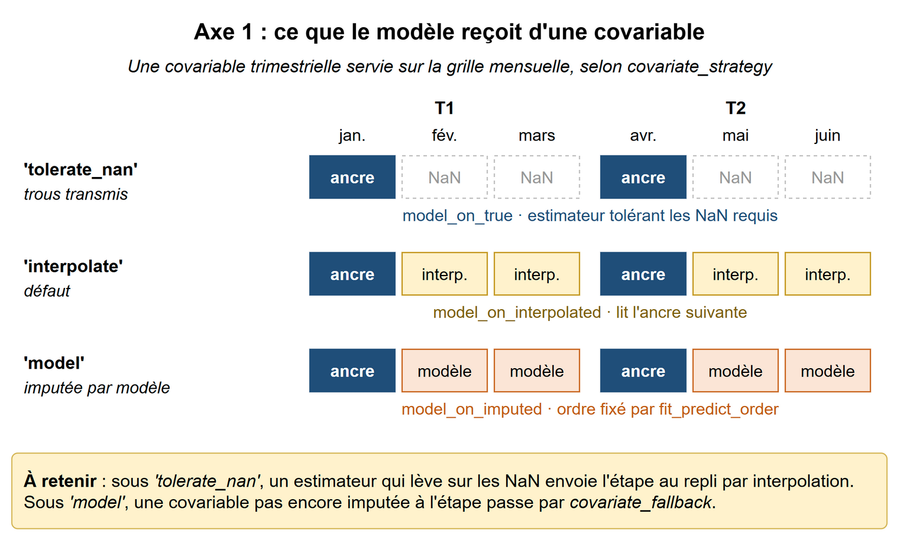
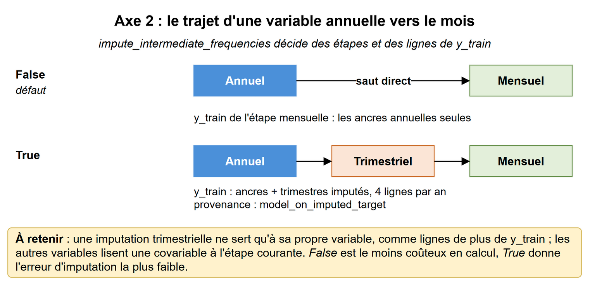

# Imputation multi-fréquences

## Le problème

Un jeu de données de prévision mélange souvent des fréquences : indicateurs mensuels,
trimestriels, annuels. Pour entraîner un modèle à la fréquence la plus fine, il faut donner
une valeur mensuelle aux variables observées une fois par trimestre ou par an, sans perdre ce qui a
été observé.

`HighFrequencyImputer` porte ces variables sur une **grille cible** plus fine
(`target_frequency`). Chaque total observé est réparti entre ses sous-périodes par un modèle, puis la
répartition peut être recalée pour que les sous-périodes redonnent exactement ce total. Chaque cellule
produite garde la trace de sa **provenance**.


## Le principe

**Additivité.** La valeur d'une période est la somme de ses sous-périodes : c'est l'hypothèse qui
justifie le recalage. Une variable non additive (niveau, taux) passe par un `additive_transformer`
(log, différenciation…) qui expose `fit_transform` et `inverse_transform`.

**Classement des variables.** Au `fit`, la fréquence de chaque colonne est détectée, par couple
(entité, colonne) sur un panel, et chaque variable est rangée dans `variable_categories_` :

| Catégorie | Variable | Traitement |
|---|---|---|
| `target_freq` | déjà à la fréquence cible | conservée |
| `impute` | plus grossière que la cible | imputée par modèle |
| `aggregate` | plus fine que la cible | agrégée exactement sur la grille |

**Un modèle par variable et par étape.** Le modèle d'une variable s'entraîne sur les dates où elle est observée (**lignes
d'ancre**). Ses covariables sont les autres colonnes du jeu de données, disponible à la fréquence de la variable que l'on cherche à prédire (cf axe 1 ci-dessous). Cible et covariables sont ramenées à l'échelle d'une période de la grille (`scale_features`) : sur une grille mensuelle, un total trimestriel est divisé par trois. Le modèle
prédit ensuite chaque sous-période, et `aggregation_constraint` recale le résultat à la bonne échelle. `estimator`
accepte un estimateur unique ou un dictionnaire par colonne ; `None` remplace tous les modèles par
une interpolation.

**Un plan figé.** `fit` enregistre les étapes de l'imputation dans un `ImputationPlan` (`imputation_plan_`), source
de vérité de l'état ajusté ; `transform` le **rejoue** sans rien réajuster. `imputation_models_`,
`frequency_progression_` et `imputation_order_` en sont des vues.

## Les deux axes du paramétrage

Le comportement de l'imputer se paramètre principalement selon **deux axes** indépendants : l'axe 1 détermine les **colonnes** données à
l'estimateur pour imputer la cible, l'axe 2 les **lignes** de sa cible.

### Axe 1 — `covariate_strategy` : comment mettre à disposition du modèle d'imputation une covariable peu observée ?



| Valeur | Ce que reçoit le modèle | Prérequis |
|--------|-------------------------|-----------|
| `'interpolate'` (défaut) | la covariable est interpolée entre ses ancres | — |
| `'tolerate_nan'` | la covariable telle qu'observée, trous compris | **l'estimateur doit tolérer les NaN**, sinon l'étape part en repli par interpolation |
| `'model'` | la covariable imputée par son propre modèle, en cascade sur les variables dans l'ordre `fit_predict_order` | — |

`'interpolate'` est le réglage le moins coûteux en calcul ; `'model'` réduit généralement l'erreur d'imputation,
au prix d'une cascade computationnellement plus coûteuse et qui dépend de l'ordre des variables.

**Règle de lecture des covariables.** Pour une variable imputée à une étape, chaque covariable est lue ainsi :

1. **La covariable est déjà imputée à cette étape** (sous `'model'`) : elle est alors lue imputée sur la grille de prédiction (elle n'est jamais
   interpolée ni écartée). Sur la grille d'entraînement, elle est :
    - observée, si la ligne est à la même fréquence  ;
    - agrégée si la ligne est à une plus basse fréquence ; sous
      `'sum'` et `'denton'`, l'agrégation des valeurs imputées à une fréquence plus fine correspond exactement aux valeurs imputées à cette fréquence plus faible, elles peuvent donc lues directement plutôt que recalculées.
2. **La covariable est interpolée ou brute sur la grille de prédiction** (stratégies `'interpolate'`
   et `'tolerate_nan'`, ou covariable pas encore imputée, servie par `covariate_fallback`). Elle est :
    - **écartée** si elle est observée à la fréquence des ancres de la variable (sur un panel, par
      au moins une entité). En effet, les valeurs de la variable sont exactes sur la grille d'entraînement mais approchée sur la grille de prédiction ce qui pourrait engendrer une importante erreur d'imputation ;
    - **conservée** sinon, toujours depuis ses ancres d'origine, jamais depuis l'imputation d'une
      étape antérieure. A une fréquence plus faible que celle de l'étape, la covariable est interpolée sur les deux grilles. A une fréquence plus élevée que l'étape d'entrainement et plus faible que celle de prédiction, elle est agrégée exactement à
      l'entraînement et interpolée à la prédiction (le PIB pour la balance annuelle) : sa qualité
      diffère entre les deux grilles, mais elle porte encore au mois son profil trimestre par
      trimestre.

Le plan nomme les covariables écartées dans `ImputationStep.dropped_covariates` et dans la colonne
`dropped_covariates` de `imputation_plan_.to_diagnostic_frame()`.

Une covariable pas encore imputée à l'étape passe par `covariate_fallback`
(`'interpolate'` par défaut, ou `'tolerate_nan'`), depuis ses ancres d'origine. L'ordre des variables d'une étape
détermine donc quelles variables sont utilisées imputées pour l'imputation d'une autre variable :

- `fit_predict_order='frequency'` (défaut) impute d'abord la variable de **fréquence source la plus
  élevée** : à l'étape mensuelle, un PIB trimestriel avant une balance annuelle. La variable la mieux
  ancrée (le plus d'observations, donc le modèle le mieux estimé) est imputée à partir de covariables
  interpolées, puis sert de covariable imputée aux variables les moins ancrées, les plus incertaines.
  Une colonne dont les entités suivent plusieurs fréquences se range à la plus basse ; une colonne
  sans aucune ancre (`impute_unobserved_entities=True`) passe après toutes les autres ;
- `fit_predict_order='cv'` ordonne les variables par score de validation croisée (`cv`, `cv_scoring`,
  `min_cv_train_size`).

Ces paramètres sont sans effet hors de `'model'`. `interpolation_method` et `interpolation_anchor` règlent la forme de toute
interpolation (covariables, replis, `estimator=None`).

!!! warning "Regard vers le futur"
    Une interpolation entre deux ancres lit l'ancre **future**. L'imputer est destiné à reconstruire l'historique du jeu de données d'entraînement et non à réaliser une simulation en pseudo temps réel.

### Axe 2 — `impute_intermediate_frequencies` : passer par des fréquences intermédiaires ?



| Valeur | Étapes (annuel → mensuel) | `y_train` |
|--------|---------------------------|-----------|
| `False` (défaut) | directe : `['M']` | ancres observées seulement |
| `True` | en cascade : `['Q', 'M']` | ancres **et** imputations antérieures de la variable |

`False` est le réglage le moins coûteux en calcul ; `True` réduit généralement l'erreur d'imputation, sous chacune
des trois stratégies. Une imputation intermédiaire ne sert qu'à la variable qu'elle impute : les
autres variables lisent une covariable à l'étape courante (axe 1).

Deux subtilités :

- Avec un estimateur linéaire non pénalisé et `aggregation_constraint=None`, `True` redonne les
  valeurs de `False` : les imputations intermédiaires se trouvent sur l'hyperplan
  ajusté, et les ré-apprendre redonne le même hyperplan. Sous `'sum'` ou `'denton'`, le recalage
  les en écarte et l'égalité disparaît, sauf lorsque le modèle intermédiaire reproduit déjà ses
  ancres (autant de paramètres que d'ancres) : le recalage est alors neutre. Un estimateur pénalisé
  ou non linéaire rompt toujours cette équivalence.
- Sous `True`, `aggregation_constraint` agit aussi sur `y_train` : sous `'sum'` et `'denton'`, une
  imputation antérieure tombant sur une date d'ancre en est retirée (elle serait une combinaison
  exacte des autres lignes) ; sous `None`, elle est conservée.

!!! note "Pourquoi une imputation intermédiaire ne sert pas toujours de covariable aux autres variables"
    À l'étape trimestrielle, le modèle de la balance commerciale annuelle lit le PIB trimestriel
    **observé**. Si, à l'étape mensuelle, le modèle du PIB lisait cette balance trimestrielle
    imputée sur ses ancres trimestrielles, la covariable contiendrait sa propre cible ; et au mois,
    faute d'imputation mensuelle de la balance, il ne pourrait la lire qu'interpolée. Avec un
    estimateur linéaire peu pénalisé, le modèle du PIB inverserait la relation, s'ajusterait presque
    sans résidu, puis prédirait au mois une interpolation de ses propres totaux trimestriels :
    l'erreur pourrait alors fortement augmenter. Pour d'autre classes de modèles, l'ajout de cette variable ne présente pas vraiment d'intérêt car elle synthétise une information disponible dans les autres covariables. La balance commerciale n'est donc lue, à l'étape mensuelle, que depuis
    ses ancres annuelles tant qu'elle n'y est pas imputée, et imputée dès qu'elle l'est.

## Provenance

Chaque cellule du résultat porte une étiquette `ProvenanceType`. L'imputeur en émet neuf :

| Famille | Niveaux | Sens |
|---|---|---|
| Non modèle | `ORIGINAL`, `AGGREGATED`, `INTERPOLATED` | valeur d'entrée, agrégation additive exacte, interpolation |
| Modèle, par pire ingrédient vu | `MODEL_ON_TRUE` → `MODEL_ON_INTERPOLATED` → `MODEL_ON_IMPUTED` → `MODEL_ON_IMPUTED_TARGET` → `MODEL_ON_IMPUTED_BOTH` | de la plus sûre à la plus dégradée |
| Sans ancre | `MODEL_UNANCHORED` | l'entité n'observe jamais la colonne (`impute_unobserved_entities=True`) |

La dixième valeur de l'énumération, `DISAGGREGATED`, n'est jamais émise : le recalage conserve la
provenance de la valeur recalée.

La matrice de la **dernière passe** (`fit`, puis chaque `transform`) est exposée dans
`imputation_provenance_`, son résumé est disponible dans `provenance_statistics_`. Elle décrit les cellules de la sortie : une colonne plus fine que la grille y porte
l'agrégation exacte de la période (`AGGREGATED`), une cellule vide n'est jamais marquée (`NaN`). La
matrice est **catégorielle** (`PROVENANCE_DTYPE`) : une cellule se lit comme une simple chaîne
(`'original'`, `'model_on_true'`...) et se compare directement à un membre
(`provenance == ProvenanceType.ORIGINAL`).

La provenance ne voit que ce que l'imputeur produit : des NaN comblés à l'intérieur de l'estimateur
(un `SimpleImputer` dans un `Pipeline`) n'y apparaissent pas.

## Contrainte d'agrégation

Laissées libres, les sous-périodes prédites n'ont aucune raison de sommer à l'observation qu'elles
décrivent. La contrainte en fait une vraie **désagrégation** de l'observation, de deux façons :

| Valeur | Recalage | Forme de la série |
|---|---|---|
| `'sum'` (défaut) | au prorata : chaque période est multipliée par le rapport total observé / somme prédite | une **marche** aux frontières de deux périodes de rapports différents, très visible après une interpolation, dont le profil est lisse |
| `'denton'` | étalonnage de Denton additif : on ajoute aux prédictions la correction la plus lisse (moindres carrés de ses différences premières) qui respecte tous les totaux, calculée par entité sur toute la série | aucune marche ; les mouvements des prédictions sont conservés |
| `None` | aucun | prédictions libres |

Un dictionnaire paramètre la contrainte par colonne. Les deux recalages respectent exactement les
totaux des périodes complètes. Le recalage additif ne divise par rien : une variable qui change de
signe (une balance commerciale) n'a ni période de somme nulle ni profil inversé, deux cas où le
prorata laisse les prédictions brutes ou retourne le signe de chaque sous-période. Sous `'denton'`,
la valeur d'un mois dépend aussi des totaux des périodes voisines, et les cellules qu'aucun total ne
contraint (bords de la fenêtre) reçoivent, à plat, la correction de la période la plus proche.

Les marches sont généralement plus marquées après une interpolation qu'après un modèle car le modèle
s'entraîne sur les ancres elles-mêmes, si bien que la somme de ses prédictions à haute fréquence est déjà
proche du total observé (un modèle linéaire restitue sa valeur ajustée ; elle est exacte s'il a autant
de paramètres que d'ancres) ; la somme d'une interpolation, décalée d'une demi-période, s'en écarte au
contraire structurellement. Le profil d'un modèle bouge en outre d'un mois à l'autre, ce qui rend une
marche de même taille moins visible.

Le recalage ne change jamais la provenance d'une cellule. Une période que les bornes des données ou
de la fenêtre tronquent ne se voit pas imposer son total : un total annuel ne s'impose pas à dix mois
sur douze. Un avertissement unique par passe le signale, comme, sous `'sum'`, les périodes dont la
somme prédite est nulle, laissées inchangées.

## Fenêtres

Trois fenêtres coexistent, chacune exposée comme masque booléen et comme bornes :

| Fenêtre | Attributs | Réglage |
|---|---|---|
| stricte : toutes les variables disponibles | `strict_window_mask_` | — (diagnostic seulement) |
| de prédiction : les lignes écrites | `imputation_window_mask_`, `imputation_window_` | `imputation_scope`, `coverage_threshold` |
| d'entraînement : les lignes vues par les modèles | `training_window_mask_`, `training_window_` | `training_scope`, `training_coverage_threshold` |

`imputation_scope` étend la fenêtre stricte vers le passé, l'avenir ou les deux
(`'extended_backward'`, `'extended_forward'`, `'extended_both'`) ; une période n'y entre que si sa
couverture atteint `coverage_threshold`. `training_scope` suit `imputation_scope` par défaut
(`None`). Ce paramètre **ajoute des lignes, jamais des colonnes** : le choix des covariables reste fixé par
leur disponibilité au moment de la prédiction. Borner l'entraînement (`training_scope='strict'`)
tout en étendant la prédiction évite d'apprendre sur des périodes pauvres en covariables.

## Panels

Sur un panel, toutes les opérations sont effectuées par couple (entité, colonne) : une même colonne peut être annuelle
pour une entité et trimestrielle pour une autre, et `target_frequency` accepte un dictionnaire par
entité.

- **Jeu d'entraînement mutualisé.** Le modèle d'une variable s'entraîne sur toutes les entités qui
  l'observent, chacune ramenée à l'échelle de l'étape. Cela suppose des niveaux comparables entre
  entités : `scale_features` ne corrige que l'échelle de fréquence.
- **Provenance contagieuse.** Une entité qui apporte des cellules interpolées ou imputées dégrade la
  provenance de toutes les cellules que l'étape produit, y compris celles concernant d'autres entités car le modèle est entraîné sur des données approximatives.
- **Colonne absente d'une entité.** `covariate_eligibility='any_entity'` (défaut) garde comme
  covariable une colonne observée par au moins une entité ; `'all_entities'`
  écarte une colonne qui n'est pas observée par toutes les entités. Il s'agit du choix le plus sûr pour un estimateur qui ne tolère pas les NaN.
- **Entité sans observation d'une colonne.** Sous `impute_unobserved_entities=True`, l'entité reçoit
  une imputation complète apprise sur les autres entités, marquée `MODEL_UNANCHORED`, ni recalée ni divisée
  (`unanchored_pairs_`). Au `transform`, le paramètre gouverne aussi les couples que le `fit` n'a
  jamais vus (entité nouvelle, colonne laissée vide) : sous `False` ils restent tels quels ; sous
  `True`, chacun est imputé par le modèle figé de sa colonne, ancré sur ses propres observations
  quand le `transform` en a.

## Sortie

Le résultat empile les niveaux de fréquence de la progression sur le côté « entité » de l'index :
`(frequency, date)` pour une série, `(entité..., 'frequency', 'date')` pour un panel.
`keep_lower_frequencies=False` ne garde que la fréquence cible, sans niveau `frequency` dans l'index : il s'agit d'un paramètre
d'affichage, sans effet sur les valeurs. Le nom `'frequency'` est **réservé** : `fit` et `transform`
refusent une entrée dont un niveau d'index ou une colonne le porte déjà.

La sortie suit l'ordre de l'entrée et porte les lignes de la grille cible : une grille densifiée
(index irrégulier) en ajoute ; une cible plus grossière que l'index en retire, la valeur d'une ligne retirée étant agrégée sur la ligne de sa période. `inverse_transform` défait la dernière passe et 
rend l'index de son entrée : sans `restore_original_values`, seules les cellules `ORIGINAL` y
reviennent ; avec, toutes les valeurs observées.

Une colonne ne mêle jamais, à un niveau de fréquence, des totaux de période et des valeurs de
sous-période. Dans la fenêtre, la ligne d'ancre reçoit la valeur de sous-période produite ; **hors de
la fenêtre**, les lignes gardent leurs valeurs d'entrée, sauf les totaux des colonnes imputées, qui
restent vides : le total trimestriel d'un PIB n'a pas sa place sur une ligne mensuelle. Ces totaux se
retrouvent par `inverse_transform` sous `restore_original_values=True`, et au niveau empilé de leur
propre fréquence quand la progression en comporte un. Une entité laissée intacte (absente du `fit`
sous `impute_unobserved_entities=False`) garde ses valeurs d'entrée.

Les dates de toute passe sont dans l'unité des dates du `X` de cette passe (`s`, `ms`, `us` ou
`ns`), y compris pour `y` ; les valeurs ne changent jamais.

## Dans un pipeline entraîné avec `y`

Entraîné avec `y`, `HighFrequencyImputer` **augmente un jeu d'entraînement** (`X` et `y`) ; il n'a
pas vocation à transformer des données de test. Un `XYPipeline` appelle `fit_transform` sur ses
étapes pendant son `fit`, et `transform` pendant `predict` / `score` : les deux passes diffèrent.

| Appel | Passe | Ce qui sort |
|---|---|---|
| `fit_transform(X, y)` | entraînement | `X` **et** `y` sur la grille cible, lignes ajoutées comprises |
| `transform(X)` / `transform(X, y)` | prédiction | les colonnes de `X` seules, imputées par les modèles figés, **sur les lignes d'entrée** ; `y` rendu **inchangé** |

Par défaut `y` est imputé comme une colonne, mais n'est **pas une covariable** des autres colonnes
(`target_as_covariate=False`) : dans un pipeline la passe de prédiction n'a en effet pas de `y` disponible pour alimenter un tel
modèle. `target_as_covariate=True` rétablit ce rôle ; la passe de prédiction lève alors une erreur si un
modèle de `X` lit `y`. Ajusté **sans** `y`, rien de cela ne s'applique : `transform` rejoue le plan
sur n'importe quelles données, et `fit_transform(X)` égale `fit(X).transform(X)`.

### Cible observée moins souvent que la grille

Quand `y` est trimestriel et la grille mensuelle, le modèle impute une **valeur mensuelle** qui n'est pas à la même échelle que les valeurs dans `y`(qui valent le **total trimestriel** sur la ligne d'ancre, NaN ailleurs). [`RollingAggregator`](../api/xy/RollingAggregator.md) (`window='Q'`)
résout l'écart : placé après l'imputeur, il fait de chaque mois un **trimestre glissant**, et, sur
une ligne d'ancre, la somme glissante redonne exactement le total observé. Il suit la même
convention que l'imputeur : `y` n'est agrégé qu'à la passe d'entraînement. Le sens de la fenêtre
suit la position de la grille (`alignment='auto'`) : passée `[t-2, t]` sur une grille de fin de
période (`ME`), future `[t, t+2]` sur une grille de début (`MS`).


[`DropNaNTarget`](../api/xy/DropNaNTarget.md), juste avant l'estimateur, retire les lignes sans
cible au `fit` et au `score`. Un scorer textuel (`scoring='neg_mean_absolute_error'`) comparerait les
prédictions au `y` de test brut, NaN compris, et lèverait une erreur. Utiliser le score par défaut du pipeline ou
un scorer restreint aux lignes observées permet de résoudre ce problème (voir le [tutoriel](../tutorials/mixed_frequency_imputation.md#7-dans-un-pipeline-une-cible-annuelle)).

Les délais de publication se comptent à la fréquence propre de chaque colonne : ils s'appliquent
**avant** l'imputeur, qui ne répartit alors que des totaux déjà publiés. `PublicationDelayTransformer`
n'est pas une étape XY et, sous `'shift'`, ajoute des dates à `X` : il s'applique donc à `X` avant
la validation croisée, ramené aux lignes de `y`. Le décalage ne dépend pas de la cible et
n'introduit pas de fuite. `prediction_date` le fixe pour toute la série : c'est la date à laquelle
les prévisions évaluées sont censées être produites ; laissée à `'today'`, elle rend le résultat
dépendant du jour d'exécution (voir [Pipeline XY](xy_pipeline.md#la-solution)).

```python
X_delayed = (
    PublicationDelayTransformer(delays=delays, strategy="shift", prediction_date="2024-01-15")
    .fit_transform(X)
    .reindex(X.index)
)

pipeline = XYPipeline([
    ("imputer", HighFrequencyImputer(target_frequency="M", estimator=LinearRegression(),
                                     keep_lower_frequencies=False)),
    ("roll", RollingAggregator(window="Q", agg="mean")),
    ("drop", DropNaNTarget()),
    ("model", HistGradientBoostingRegressor()),
])
```

## Architecture du code

`HighFrequencyImputer` est un orchestrateur : la classe valide les paramètres, publie les attributs
ajustés et enchaîne les phases ; chaque phase vit dans un module de
`tsforecast/imputation/_engine/`. Le `fit` et le `transform` partagent la **même préparation** et la
**même exécution d'étape**.


Le contexte d'exécution (`_RunContext`) n'est jamais stocké sur l'imputeur : chaque passe reçoit son
matérialiseur, ses registres, son calculateur de fenêtre, son traceur de provenance et ses
avertissements en attente. Un `transform` ne lit ni n'altère aucun état d'exécution du `fit`.

| Module (`_engine/`) | Rôle |
|---------------------|------|
| `params` | validateurs purs des paramètres du constructeur |
| `frequency_layout` | `FrequencyLayout` figé et `plan_frequencies` : fréquence de chaque couple (entité, colonne), catégories de variables, progression des étapes |
| `preparation` | `prepare_work_frame` : phases communes au `fit` et au `transform` |
| `run_context` | `FittedComponents` (configurés au `fit`, relus par toute passe) et `_RunContext` (état d'une passe) |
| `grids` | grilles de prédiction et masques de fenêtre d'une étape |
| `row_scaling` | `RowScaler` : diviseurs par ligne des jeux d'entraînement mutualisés |
| `stage_runner` | `StageRunner` : ajustement d'une étape (`fit_stage`) et exécution d'une étape du plan (`execute_step`) |
| `replay` | rejeu du plan, contrôles du `transform`, entités nées au `transform` |
| `output` | assemblage de la sortie et gestes de l'inversion |
| `warnings` | `WarningAccumulator` : un avertissement par famille et par passe |

Les composants réutilisables vivent dans `_components/` :

| Composant | Rôle |
|-----------|------|
| `CovariateMaterializer` | produit `X_train` / `X_pred` ; la prédiction ne dispose jamais de moins d'information que l'entraînement |
| `StageScaler` | met les deux côtés du modèle à la même échelle de fréquence |
| `AggregationConstraint` | recale les sous-périodes sur le total observé |
| `VariableOrderer` | ordonne les variables (`'frequency'` ou `'cv'`), expose `scores_` |
| `TrainingSetBuilder` | jeu d'entraînement mutualisé entre entités d'un panel |
| `ImputationWindowCalculator` | fenêtres de prédiction et d'entraînement |
| `TargetFrequencyValidator` | cohérence fréquence cible ↔ fréquences détectées |

`_engine/` et `_components/` sont des détails d'implémentation : l'API publique est celle de la
classe et des types réexportés par `tsforecast.imputation`. `FrequencyAligner` et `IndexRegularizer`
(`tsforecast.utils.frequency`) sont des outils autonomes que l'imputeur n'utilise pas.

## Pour aller plus loin

- Tutoriel : [Imputation multi-fréquences](../tutorials/mixed_frequency_imputation.md)
- Notebook : `notebooks/2 - QB - Mixed frequencies.ipynb`, qui illustre chaque paramètre
- API : [HighFrequencyImputer](../api/imputation/HighFrequencyImputer.md),
  [provenance](../api/imputation/provenance.md),
  [aggregation_constraint](../api/imputation/aggregation_constraint.md),
  [stage_runner](../api/imputation/engine/stage_runner.md) (internals),
  [RollingAggregator](../api/xy/RollingAggregator.md)
- Métriques de tracking : [`imputation_metrics`](../guides/mlflow_tracking.md)
