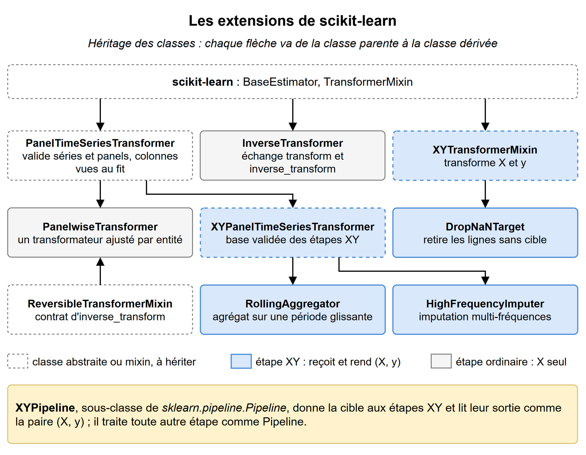
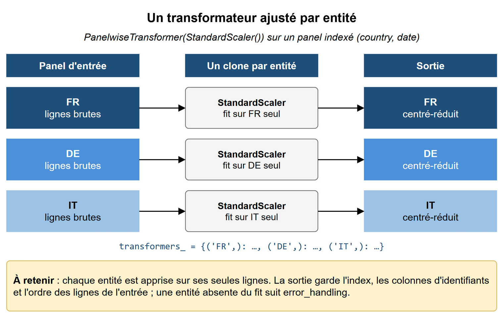
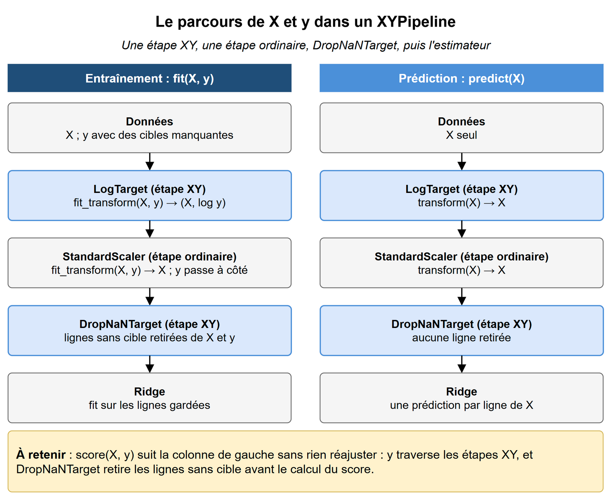
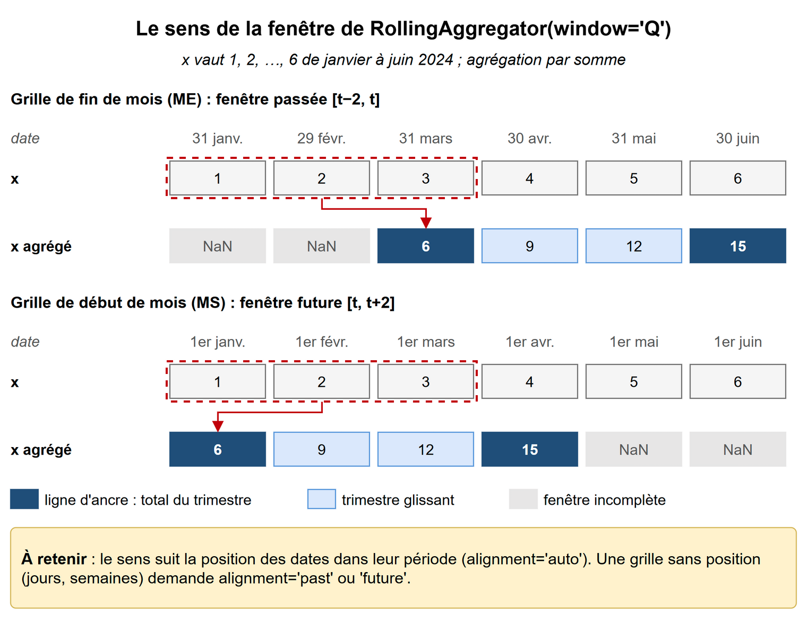

# Extensions de scikit-learn

## Le problème

scikit-learn traite les lignes d'un jeu de données comme interchangeables : ses transformateurs
ignorent les dates et les entités, et un `Pipeline` ne transforme que `X`, la cible arrivant intacte
à l'estimateur. Une prévision sur séries temporelles ou sur panel peut demander :

- de **valider la structure temporelle** avant d'apprendre : des dates, triées, sans doublon, et
  des entités groupées ;
- d'**apprendre certaines transformations entité par entité** : un pays ne se centre pas sur la
  moyenne d'un autre, et une variation ne se calcule pas entre la dernière ligne d'un pays et la
  première du suivant ;
- de **transformer la cible avec les covariables** : l'associer à un horizon de prévision, retirer
  les lignes sans cible, l'agréger ou l'imputer sur une autre grille.

## Vue d'ensemble

| Besoin | Classe | Module |
|--------|--------|--------|
| Écrire un transformateur qui valide séries et panels | `PanelTimeSeriesTransformer` | `tsforecast.base` |
| Rendre une transformation réversible, ou l'inverser dans un pipeline | `ReversibleTransformerMixin`, `InverseTransformer` | `tsforecast.base` |
| Ajuster un transformateur sklearn par entité | `PanelwiseTransformer` | `tsforecast.panel` |
| Faire passer la cible par les étapes d'un pipeline | `XYPipeline`, `XYTransformerMixin`, `XYPanelTimeSeriesTransformer` | `tsforecast.xy` |
| Retirer les lignes sans cible avant l'estimateur | `DropNaNTarget` | `tsforecast.xy` |
| Agréger sur une période calendaire glissante | `RollingAggregator` | `tsforecast.xy` |

Toutes ces classes suivent le contrat de sklearn (`fit`, `transform`, `get_params`, `set_params`,
`clone`) : elles s'utilisent dans `GridSearchCV`, `cross_validate` et avec les splitters de
[`tsforecast.crossvals`](cross_validation.md).

## Classes de base des transformateurs

### `PanelTimeSeriesTransformer`

Cette classe est une classe abstraite d'un transformateur qui accepte **une série comme un panel**. Une sous-classe écrit
`_fit(X, y)` et `_transform(X)` ; les méthodes publiques `fit` et `transform` préparent les données
avant de les lui passer.

| Disposition | Paramètres | Ce que reçoit la sous-classe |
|-------------|------------|------------------------------|
| Série indexée par des dates | — | index converti en `DatetimeIndex` |
| Panel indexé par un `MultiIndex` (entités, puis dates) | — | dernier niveau converti en dates |
| `DataFrame` plat | `time_col`, et `panel_cols` pour un panel | colonnes converties, laissées en place ; passées dans l'index sous `convert_cols_to_index=True` |

La validation, faite sur une copie (l'entrée n'est jamais modifiée), lève une `ValueError` pour :

- une entrée qui n'est pas un `DataFrame` : une série se passe sous la forme `series.to_frame()` ;
- des étiquettes temporelles qui ne sont pas des dates. Des chaînes de dates et des `Period` (lues
  à leur premier instant) sont acceptées ; un `RangeIndex` ou des années entières sont refusés ;
- au `transform`, des colonnes autres que celles du `fit`, ou dans un autre ordre (règle de sklearn).

Un couple (entité, date) répété, des dates non triées et des entités dont les lignes ne sont pas
contiguës lèvent aussi une `ValueError`, ou un simple avertissement sous `strict_validation=False`.
`auto_sort=True` trie une copie par entité puis par date.

Le `fit` enregistre les attributs de la convention sklearn : `is_panel_`, `n_features_in_`,
`feature_names_in_`. Les colonnes `time_col` et `panel_cols` laissées en place comptent parmi ces
colonnes et parviennent à `_fit` et `_transform`, qui doivent donc les ignorer ;
`convert_cols_to_index=True` les en retire en les passant dans l'index, et enregistre dans
`conversion_metadata_` de quoi les rendre.

### `ReversibleTransformerMixin` et `InverseTransformer`

`ReversibleTransformerMixin` déclare `inverse_transform` abstraite (une sous-classe qui ne l'écrit
pas ne s'instancie pas) et fournit `_restore_structure_if_converted`, qui rend la structure vue au
`fit` : les `Period` d'un index de périodes et les colonnes passées dans l'index, à leur position
d'origine (avec un `RangeIndex` neuf).

`InverseTransformer` enveloppe un transformateur **déjà ajusté** et échange `transform` et
`inverse_transform`. Comme `sklearn.frozen.FrozenEstimator`, c'est une étape pré-ajustée : son
`fit` ne fait rien et `clone` rend l'enveloppe elle-même, si bien qu'elle garde son ajustement dans
`Pipeline`, `cross_validate` ou `GridSearchCV`. Un `set_params` sur un « clone » modifie donc
l'original.

`TimeSeriesTransformerMixin` fournit l'extraction de l'index temporel (`_validate_time_index`) sur
laquelle s'appuient les autres classes.

## Transformations par entité : `PanelwiseTransformer`

`PanelwiseTransformer` enveloppe un transformateur sklearn, ou un pipeline, et l'ajuste
**indépendamment sur chaque entité** : chaque entité reçoit son propre clone, ajusté sur ses seules
lignes, et `transformers_` les range par clé d'entité (un tuple, `('FR',)`).

Trois modes fixent le transformateur de chaque entité :

| Mode | `transformer` | Effet |
|------|---------------|-------|
| Simple | un estimateur | cloné à l'identique pour chaque entité |
| Fabrique | `Callable[[clé], estimateur]` | appelé avec la clé de chaque entité |
| `entity_kwargs` | un estimateur, et `{entité: paramètres}` | cloné, puis `set_params(**paramètres)` par entité ; `default_entity_kwargs` pour les autres |

Une fabrique l'emporte sur `entity_kwargs`, alors ignoré avec un avertissement. Une clé scalaire
désigne une entité à un niveau : `'FR'` vaut `('FR',)`.

**Disposition de la sortie.** Le panel est lu dans un `MultiIndex` (entités, puis dates) ou dans les
colonnes `panel_cols` et `time_col` (défaut `'date'`) d'un `DataFrame` plat. Chaque clone reçoit les
lignes de son entité indexées par leurs dates, colonnes d'identifiants exclues. La sortie garde la
disposition, les étiquettes et l'ordre des lignes de l'entrée tant que chaque clone rend des lignes
de son entrée ; sinon, les entités sont mises bout à bout dans leur ordre d'apparition. Un clone qui
change le nombre de colonnes (`PCA`, `OneHotEncoder`) donne ses noms par `get_feature_names_out`.

**Entités inconnues et erreurs.** Une entité absente du `fit`, ou dont le clone échoue, suit
`error_handling` : `'raise'` (défaut) lève l'erreur (une `ValueError` pour une entité inconnue),
`'warn'` et `'ignore'` rendent ses lignes inchangées, avec ou sans avertissement. Les entités en
échec au `fit` sont listées dans `failed_entities_`.

**Autres points.** `n_jobs` parallélise l'ajustement (joblib) ; la transformation reste
séquentielle. La transformation de données vides rend une copie vide de l'entrée. `inverse_transform` inverse
chaque entité par son propre clone si le transformateur de base est réversible. Les paramètres du
transformateur enveloppé se règlent par `transformer__<paramètre>`, comme dans `GridSearchCV`.

`PublicationDelayTransformer` s'appuie sur `PanelwiseTransformer` pour appliquer des délais propres à
chaque entité. `tsforecast.panel.utils` expose les fonctions de manipulation de panels utilisées par
le package (`is_panel_data`, `get_unique_panel_entities`, `normalize_entity_key`, `get_entity_mask`,
`iter_entity_blocks`...).

## Pipeline XY

### Étapes XY et étapes ordinaires

`XYPipeline` est un remplacement direct de `sklearn.pipeline.Pipeline` qui fait passer la cible par
les **étapes XY**. Une étape est XY quand elle hérite de `XYTransformerMixin` ou de
`XYPanelTimeSeriesTransformer` (test : `is_xy_transformer`), jamais en raison de sa signature. Le
pipeline lui donne la cible (`fit_transform(X, y)`, `transform(X, y)`, `inverse_transform(X, y)`)
et lit sa sortie comme la paire `(X, y)` ; une étape XY qui rend autre chose lève une `TypeError`.
Toute autre étape est traitée exactement comme par `Pipeline` : `fit_transform(X, y)` à
l'entraînement, `transform(X)` sans la cible, et sa sortie devient le `X` de l'étape suivante.

Les méthodes de prédiction (`predict`, `predict_proba`, `predict_log_proba`, `decision_function`,
`score_samples`) ne prennent pas de `y`, comme celles de `Pipeline` : une prédiction ne dépend jamais
de la cible, et compte une valeur par ligne de `X`. `score(X, y)` fait passer la cible de test par
les étapes XY, sans rien réajuster. `inverse_transform` parcourt les étapes en ordre inverse et
inverse `X` comme `y`.

### Écrire une étape XY

Pour écrire un nouveau transformer sur X et y, il est préférable d'hériter de `XYTransformerMixin` (avec `BaseEstimator`) et écrire `_fit(X, y)`, `_transform(X, y=None)`
et, au besoin, `_inverse_transform(X, y=None)`, qui rendent `(X_t, y_t)` quand `y` est fourni et `X_t`
sinon. Le mixin fournit `fit`, `transform`, `fit_transform` et `inverse_transform`.
`XYPanelTimeSeriesTransformer` ajoute la validation de `PanelTimeSeriesTransformer` : c'est la base
de `RollingAggregator` et de `HighFrequencyImputer`.

Une étape XY peut distinguer deux passes : `fit_transform(X, y)` est la passe d'entraînement,
`transform(X, y)` la passe de prédiction et de `score`. `RollingAggregator` et `HighFrequencyImputer`
s'en servent pour ne modifier la cible qu'à l'entraînement ; `fit_transform(X, y)` diffère alors de
`fit(X, y).transform(X, y)`.

### Retirer les lignes sans cible : `DropNaNTarget`

Une étape qui associe la cible à un horizon, agrège sur une fenêtre ou augmente le jeu
d'entraînement (`HighFrequencyImputer`) laisse des lignes sans cible. `DropNaNTarget`, placée juste
avant l'estimateur, les retire de `X` et de `y` quand elle reçoit la cible (`fit`, `score`) et n'en
retire aucune sans elle (`predict`). Une cible multiple perd une ligne dès qu'une de ses colonnes
manque.

Le score par défaut de `GridSearchCV` ou `cross_validate` (`scoring=None`) est `pipeline.score`, qui
retire ces lignes. Un scorer textuel (`scoring="r2"`...) compare au contraire `pipeline.predict(X_test)`
au `y_test` brut, hors du pipeline : il reçoit les cibles manquantes (le score du pli vaut alors NaN,
avec un avertissement de sklearn) et ignore toute transformation de la cible par une étape XY. Il
faut alors un scorer qui reproduise cette transformation (exemple dans le
[tutoriel d'imputation](../tutorials/mixed_frequency_imputation.md#7-dans-un-pipeline-une-cible-annuelle)).

### Paramètres par ligne

Un paramètre d'ajustement qui compte une valeur par ligne de `X`, typiquement `sample_weight`,
**suit les lignes gardées** par les étapes XY : derrière `DropNaNTarget`, l'estimateur reçoit les
poids de ses lignes d'entraînement. C'est vrai pour `model__sample_weight=w` comme pour un paramètre
routé par le *metadata routing*, au `fit`, au `fit_transform`, au `fit_predict` et au
`score(X, y, sample_weight=w)`. Les lignes gardées sont localisées sur l'**index** de `y`, sinon de
`X` : il faut des objets pandas à index unique. Sur des tableaux numpy dont une étape XY change le
nombre de lignes, un tel paramètre est refusé par une `ValueError` plutôt que transmis désaligné.

### Sorties pandas et mise en cache

Avec `preserve_dataframe=True` (défaut), une sortie en tableau d'une entrée pandas redevient un
`DataFrame` (et la cible une `Series`) à la sortie de `fit_transform` et `transform`, avec l'index de
l'appel en cours (celui de la cible rendue, une fois des lignes retirées) et les noms donnés par
`get_feature_names_out`. À l'intérieur du pipeline, comme dans `Pipeline`, une sortie en tableau
reste un tableau : l'estimateur final n'apprend pas de noms de colonnes. `pipe.set_output(transform="pandas")`
donne des sorties pandas de bout en bout.

`memory=` (un répertoire ou un `joblib.Memory`) met en cache l'ajustement des étapes
intermédiaires, étapes XY comprises ; les étapes données au pipeline sont alors clonées et restent
non ajustées. La clé de cache lit le contenu des données (valeurs, index, colonnes, types, unité des
dates comprise).

`XYPipeline` reste compatible avec `GridSearchCV`, `RandomizedSearchCV`, `cross_validate`,
`cross_val_predict` (avec un découpage en partition), le *metadata routing* (`transform_input` compris), `joblib` et `pickle`.

## Agrégation glissante : `RollingAggregator`

`RollingAggregator` remplace chaque colonne par son agrégat (`'sum'`, `'mean'`, `'min'`, `'max'`,
`'first'`, `'last'`) sur une **période calendaire glissante**, entité par entité. Sur une grille
mensuelle, `window='Q'` fait de chaque mois un **trimestre glissant**, avec trois fois plus de
lignes qu'un jeu trimestriel.

**Deux passes.** `fit_transform(X, y)` agrège `X` et `y` (`target_agg`) ; `transform(X, y)`
agrège `X` seul et rend `y` **inchangé**. La convention sert le cas où la cible observée est déjà un
total de période (un trimestre publié) alors que le modèle apprend sur des valeurs mensuelles, par
exemple imputées par [`HighFrequencyImputer`](mixed_frequency_imputation.md#cible-observee-moins-souvent-que-la-grille).
Seule une agrégation qui reconstruit la quantité observée la suit : un logarithme ou un taux de
croissance de la cible s'applique aussi à la cible de test, par un `TransformedTargetRegressor`
autour de l'estimateur, jamais à l'entraînement seul.

**Sens de la fenêtre** (`alignment='auto'`). Il suit la position des dates de la grille : une
grille de fin de période (`ME`) reçoit une fenêtre **passée** `[t-2, t]`, une grille de début de
période (`MS`) une fenêtre **future** `[t, t+2]`. Dans les deux cas, la ligne d'ancre d'un trimestre
porte le total exact de ce trimestre. Une grille sans position (jours, semaines) demande
`alignment='past'` ou `'future'`.

**Taille de la fenêtre.** `window` est une fréquence (`'Q'`, `'Y'`, `'3M'`...) comptée en pas de la
grille de chaque entité, détectée au `fit`. La grille doit être de même base que la fenêtre ou s'y
emboîter exactement : `Y` sur `Q`, `M` ou `SM` ; `Q` sur `M` ou `SM` ; `M` sur `SM` ; `W` sur `D`.
Les dates sont lues comme des numéros de période : une date absente de la grille laisse un trou, et
la fenêtre ne glisse jamais sur une autre période.

**Fenêtres complètes seulement.** Une fenêtre à laquelle il manque une valeur (NaN, date absente,
bord des données) donne NaN. À l'entraînement, `DropNaNTarget` retire ces lignes. À la prédiction,
les premières lignes d'un jeu de test (fenêtre passée) ou ses dernières (fenêtre future) sortent en
NaN, sauf si le jeu de test commence et finit sur des bornes de période : il faut découper la
validation croisée sur des périodes entières, imputer ces valeurs (`SimpleImputer`) ou choisir un
estimateur qui tolère les NaN.

**Colonnes.** `agg` accepte un dictionnaire par colonne, avec une clé `'__default__'` (somme pour un
flux, moyenne pour un taux) ; `suffix='_q'` garde les colonnes d'origine et ajoute les agrégats après
elles. Les colonnes `time_col` et `panel_cols` sont rendues inchangées ; toute autre colonne doit
être numérique. L'étape ne fait que l'agrégation : une variation ou un logarithme de `X` après
agrégation s'ajoute par une étape ordinaire (`FunctionTransformer`, dans un `PanelwiseTransformer`
pour un calcul par entité).

## Délais de publication dans un pipeline

`PublicationDelayTransformer` n'est pas une étape XY : il ne transforme que `X`. Sous
`strategy='shift'`, il réindexe `X` sur les dates de publication, en ajoute à la fin et laisse vides
les premières périodes : dans un pipeline, `X` ne partagerait plus les lignes de `y`. Il s'applique
donc à `X` **avant** le pipeline et la validation croisée, ramené aux lignes de `y` par
`.reindex(y.index)`. Le décalage ne dépend que de la table des délais et de `prediction_date`,
jamais de la cible : l'appliquer en amont n'introduit aucune fuite.

`prediction_date` fixe le décalage de toute la série : la date choisie représente la position, dans
sa période, des prévisions que l'on évalue. Laissée à `'today'`, elle rend le décalage dépendant du
jour d'exécution. Le [tutoriel des délais](../tutorials/publication_delays.md#6-evaluer-un-modele-avec-delais)
en donne un exemple complet.

## Pour aller plus loin

- Tutoriel : [Extensions de scikit-learn](../tutorials/sklearn_extensions.md)
- Notebook : `notebooks/0 - QB - Sklearn extensions.ipynb`
- Concept lié : [Imputation multi-fréquences](mixed_frequency_imputation.md#dans-un-pipeline-entraine-avec-y),
  qui place `HighFrequencyImputer` et `RollingAggregator` dans un même `XYPipeline`
- API : [transformateurs de base](../api/base/transformers.md),
  [PanelwiseTransformer](../api/panel/PanelwiseTransformer.md),
  [utilitaires panel](../api/panel/utils.md), [XYPipeline](../api/xy/XYPipeline.md),
  [XYTransformerMixin](../api/xy/XYTransformerMixin.md),
  [XYPanelTimeSeriesTransformer](../api/xy/XYPanelTimeSeriesTransformer.md),
  [DropNaNTarget](../api/xy/DropNaNTarget.md), [RollingAggregator](../api/xy/RollingAggregator.md),
  [is_xy_transformer](../api/xy/is_xy_transformer.md)
