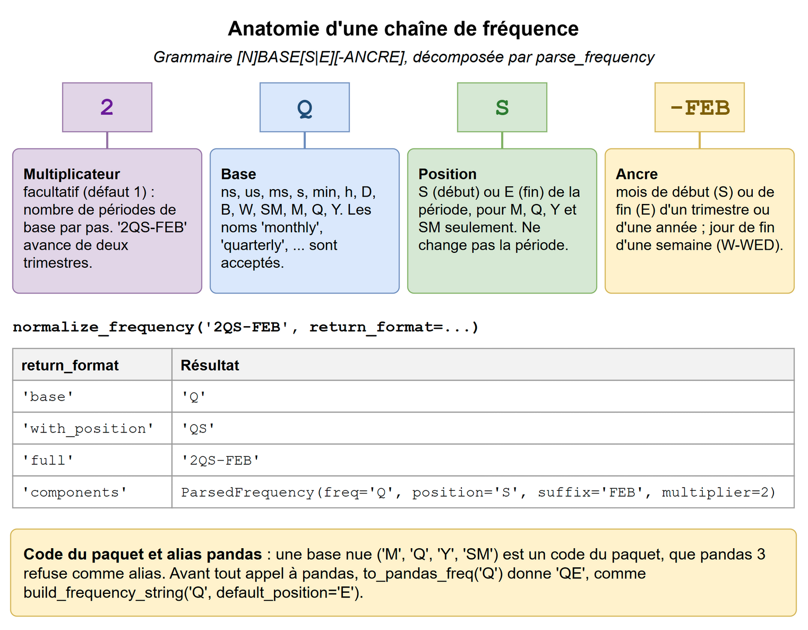
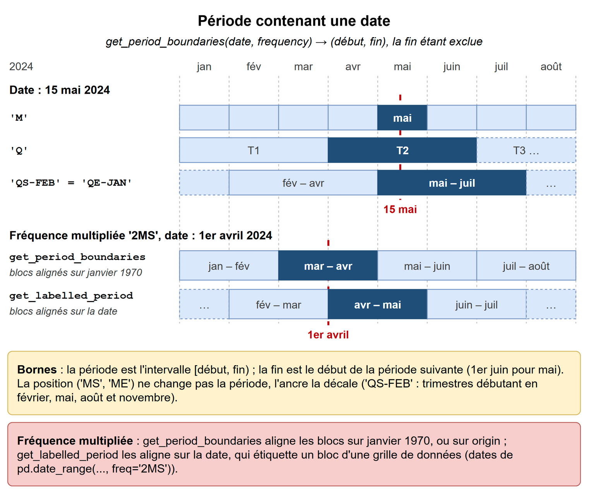
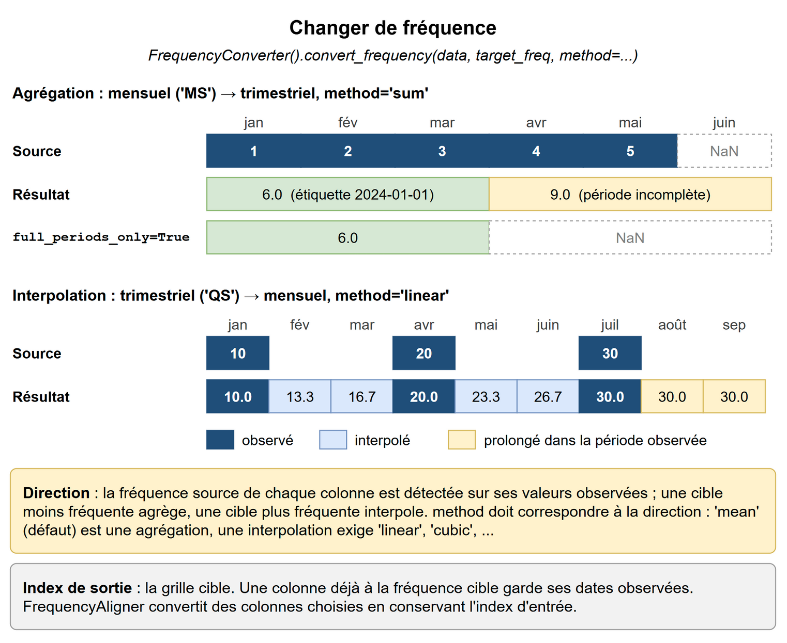

# Utilitaires temporels

## Rôle

Les composants de `tsforecast` manipulent des dates et des fréquences écrites de façons multiples : une même
fréquence trimestrielle s'écrit `'Q'`, `'QS'`, `'QE-DEC'` ou `'quarterly'`, une observation mensuelle
est datée du premier ou du dernier jour de son mois, une date est stockée en secondes ou en
nanosecondes. `tsforecast.utils` fixe une seule interprétation de ces écritures, partagée par tout le
package.

| Module | Rôle | Fonctions principales |
|--------|------|-----------------------|
| `parse` | grammaire des chaînes de fréquence | `parse_frequency`, `build_frequency_string` |
| `frequency` | normaliser, comparer, détecter et changer une fréquence | `normalize_frequency`, `to_pandas_freq`, `is_higher_frequency`, `detect_frequency`, `is_regular`, `regularize` ; classes `FrequencyConverter`, `FrequencyAligner` |
| `time` | bornes de périodes, dates, unité de stockage | `get_period_boundaries`, `get_labelled_period`, `resolve_date`, `as_exact_unit` |
| `position` | position d'une date dans sa période | `convert_position`, `convert_offset`, `flip_position` |
| `duration` | unités de durée | `normalize_duration`, `convert_duration` |
| `validation` | structure des séries et des panels | `validate_temporal_data`, `restore_original_structure`, `validate_entities_grouped`, `validate_sorted_within_groups` |

Chaque module suit le même canevas : une classe `*Normalizer` (forme canonique), une classe
`*Converter` (conversion) et des fonctions qui s'appuient sur elles. Les fonctions couvrent l'usage
courant ; les classes `FrequencyDetector` et `IndexRegularizer` sont exposées par `detect_*`,
`is_regular` et `regularize`. Seul le changement de fréquence n'a pas de fonction équivalente et passe
par `FrequencyConverter` ou `FrequencyAligner`. `TemporalNormalizer` et `TemporalConverter`
(`utils/abc/`) définissent le contrat commun des Normalizer et des Converter.

## Fréquences

### Grammaire

Une fréquence s'écrit comme un alias pandas, `[N]BASE[S|E][-ANCRE]`. `parse_frequency` la décompose
en un `ParsedFrequency(freq, position, suffix, multiplier)` et `build_frequency_string` l'assemble ;
ce sont les deux seules fonctions qui manipulent le texte d'une fréquence.

- **Bases** : `ns`, `us`, `ms`, `s`, `min`, `h`, `D`, `B`, `W`, `SM`, `M`, `Q`, `Y`. Les noms
  littéraux forment une liste fermée : `'nanosecond'`, `'microsecond'`, `'millisecond'`, `'second'`,
  `'minute'`, `'hourly'`, `'daily'`, `'business_daily'`, `'weekly'`, `'semi_monthly'`, `'monthly'`,
  `'quarterly'`, `'annual'`.
- **Position** : `S` (début) ou `E` (fin), pour `M`, `Q`, `Y` et `SM` seulement. Elle date
  l'observation dans sa période sans changer la période.
- **Ancre** : jour de fin d'une semaine (`W-WED`), mois de début (`QS-FEB`) ou de fin (`QE-JAN`) d'un
  trimestre ou d'une année. Elle décale les périodes.
- **Multiplicateur** : nombre de périodes de base par pas (`2MS`, `15min`).

`normalize_frequency` valide une fréquence et la rend au niveau de détail de `return_format` :
`'base'` (`'Q'`), `'with_position'` (`'QS'`), `'full'` (la chaîne complète, multiplicateur compris)
ou `'components'` (le `ParsedFrequency`). Une ancre inexistante (`'QE-XYZ'`) lève une `ValueError` ;
`validate_frequency` fait le même contrôle et renvoie un booléen.

### Code du package et alias pandas

Une base nue (`'M'`, `'Q'`, `'Y'`, `'SM'`) est un **code du package** : elle désigne une période sans
position et sert aux comparaisons, aux durées et aux paramètres. Pandas 3 la refuse comme alias et
exige une variante explicite. Toute fréquence transmise à pandas (`pd.date_range`, `resample`,
`to_offset`) passe donc par `to_pandas_freq`, qui donne la variante de fin de période (`'Q'` →
`'QE'`), ou par `build_frequency_string(..., default_position=...)`.

### Forme canonique et comparaison

Plusieurs ancres trimestrielles décrivent les mêmes dates (`'QS-JAN'`, `'QS-APR'`, `'QS-JUL'`,
`'QS-OCT'`) et `pd.infer_freq` renvoie l'une quelconque. `canonicalize_frequency` ramène chaque
écriture à un représentant unique : le premier mois de l'année pour une position de début
(`'QS-JAN'`, `'QS-FEB'`, `'QS-MAR'`), le mois précédent pour une position de fin (`'QE-DEC'`,
`'QE-JAN'`, `'QE-FEB'`). Les fonctions de détection rendent cette forme.

`is_higher_frequency(a, b)` teste si `a` est plus fine que `b`, multiplicateur compris : `'MS'` est
plus fine que `'2MS'`, `'2MS'` que `'QS'`, et `'3MS'` n'est ni plus ni moins fine que `'QS'`. Les
bases emboîtées (quinzaine, mois, trimestre, année ; jour et semaine) se comparent en nombre exact de
sous-périodes (`'12MS'` et `'YS'` ont la même longueur), les autres par leur durée conventionnelle.
`get_frequency_order` donne un rang (plus petit = plus fin) qui ignore le multiplicateur ; `B` et
`SM` y ont des rangs non entiers (7,5 et 8,5), entre leurs voisins.

### Détection

`detect_index_frequency` lit la fréquence d'un index (chaînes de dates et `Period` acceptés, index
désordonné trié au préalable) ; `detect_frequency` celle de chaque colonne d'un `DataFrame`, ou de
chaque couple (entité, colonne) d'un panel. Les règles :

- la fréquence d'une colonne se lit sur ses **valeurs observées**, non sur l'index : une variable
  trimestrielle portée par un index mensuel est trimestrielle ;
- quand pandas ne reconnaît aucune fréquence (dates manquantes, espacements irréguliers), la
  détection retient l'**espacement modal** entre dates consécutives : une grille mensuelle lacunaire
  reste `'MS'`. La détection n'est donc pas un test de régularité ;
- une colonne ou une entité de moins de deux observations reçoit `None` ;
- sur un panel, les clés sont des tuples `(entité..., colonne)` ; celles de
  `detect_index_frequency` sont des tuples `(entité...,)`, même pour un seul niveau d'entité ;
- `check_consistency=True` réduit le résultat à une fréquence : la plus fréquente
  (`consistency_mode='modal'`) ou la plus fine (`'highest'`). Avec `strict=True` (défaut), le paramétrage
  modal renvoie `None` dès que deux fréquences diffèrent.

`is_regular` teste qu'un index est une grille complète (au moins trois dates, aucune répétée) ;
`regularize` la complète par des lignes `NaN`, chaque entité d'un panel sur sa propre étendue. Une
observation hors de la grille détectée est écartée, avec un avertissement.

## Périodes

`get_period_boundaries(date, frequency)` renvoie le début et la fin de la période de `frequency` qui
contient `date` ; `get_period_start` et `get_period_end` en renvoient une borne.

- **Intervalle semi-ouvert** : la période est `[début, fin)`, la fin étant le premier instant de la
  période suivante. C'est une date exacte, là où `Period.end_time` de pandas vaut
  `23:59:59.999999999`.
- **Ancres** : `'W-WED'` désigne les semaines du jeudi au mercredi, `'QS-FEB'` et `'QE-JAN'` les
  trimestres février-avril, mai-juillet..., `'YS-JUL'` les exercices de juillet à juin. La position ne
  change pas la période.
- **Fréquences multipliées** (`'2MS'`, `'3D'`, `'6h'`) : `get_period_boundaries` aligne les blocs de
  *n* périodes sur l'époque Unix (janvier 1970), ou sur le paramètre `origin`.
  `get_labelled_period` lit la date comme l'étiquette d'un bloc d'une grille de données : le bloc
  commence à la date pour une fréquence de début de période ou sans position (`'2MS'`, `'3D'`), il
  finit avec elle pour une fréquence de fin de période ou hebdomadaire (`'2ME'`, `'2W-SUN'`). Sans
  multiplicateur, les deux fonctions coïncident.
- **Entrées** : `datetime`, `Timestamp`, `numpy.datetime64` ou `Period` (représenté par son premier
  instant). Le fuseau horaire est conservé ; les fréquences calendaires suivent l'heure locale (un jour
  de changement d'heure dure 23 ou 25 heures), les fréquences infra-journalières découpent l'heure
  locale (une heure commence à `HH:00`).
- **Unité** : les bornes sont dans l'unité de la date (`us` pour un `datetime` ou un `Period`), plus
  fine si la borne l'exige (fin d'une période `'ns'` d'une date en secondes).

## Position dans la période

Une observation peut être datée du début ou de la fin de sa période. `convert_position(value,
from_position, to_position, freq=None)` déplace les dates d'un index, d'une série ou d'un
`DataFrame` ; `convert_offset` convertit une chaîne de fréquence ; `flip_position` donne la position
opposée. Les positions s'écrivent `'S'` / `'E'` ou `'start'` / `'end'`.

- Seules les fréquences à variantes début / fin portent une position : `M` (`MS` / `ME`), `Q`, `Y` et
  `SM`, avec multiplicateur et ancre éventuels (`2MS`, `QS-FEB`, `YE-JUN`). Les autres (`D`, `B`,
  `W-SUN`, `h`...) sont rendues inchangées.
- Une date convertie tombe sur la grille native pandas de l'offset cible (`MS` converti en fin donne
  exactement `pd.date_range(freq='ME')`, à minuit), dans la période de sa date source ; l'ancre décrit
  les mêmes périodes (`QS-FEB` ↔ `QE-JAN`).
- `freq`, détectée si elle est absente, délimite les périodes. Une conversion ne fusionne jamais deux
  dates : une `freq` plus grossière que les données lève une `ValueError`.

## Changer de fréquence

`FrequencyConverter().convert_frequency(data, target_freq, method=...)` change la fréquence d'une
série, d'un `DataFrame` ou d'un panel, entité par entité.

- **Direction** : la fréquence source de chaque colonne est détectée sur ses valeurs observées. Une
  cible moins fréquente agrège (`method` parmi `'mean'`, `'sum'`, `'first'`, `'last'`, `'min'`,
  `'max'`, `'median'`, `'std'`, `'count'`, `'all'`, `'any'`), une cible plus fréquente interpole
  (`'linear'`, `'time'`, `'index'`, `'values'`, `'nearest'`, `'zero'`, `'slinear'`, `'quadratic'`,
  `'cubic'`). Le `method` par défaut, `'mean'`, est une agrégation : une interpolation doit préciser
  le sien, sinon une `ValueError` est levée.
- **Étiquettes** : la position cible est celle de `target_position`, sinon celle de `target_freq`
  (`'QE'`), sinon celle de la source (des données `'MS'` agrégées en `'Q'` sont étiquetées en début de
  trimestre), sinon la fin.
- **Agrégation** : les `NaN` sont ignorés et une période incomplète est agrégée sur ses seules
  observations ; `full_periods_only=True` la met à `NaN`. Une période sans observation donne `NaN`.
- **Interpolation** : la série relie ses observations, puis la première et la dernière sont
  prolongées sur toute leur période (une observation `'QS'` couvre les deux mois qui la suivent, une
  observation `'QE'` les deux qui la précèdent). `limit` borne le nombre de valeurs consécutives
  comblées : par défaut, le nombre de sous-périodes d'une période (3 du trimestre au mois) ; `None`
  ne fixe aucune borne. `limit_direction` (par défaut `'forward'` pour une position de début,
  `'backward'` pour une position de fin) et `limit_area` suivent `pandas.Series.interpolate`.
- **Plusieurs colonnes** : `target_freq` est une fréquence commune ou un dictionnaire
  `{colonne: fréquence}` (sur un panel, aussi `{(entité...,): fréquence}` ou
  `{(entité..., colonne): fréquence}`). L'index de sortie est la réunion des grilles cibles ; une
  colonne non convertie (déjà à la fréquence cible, absente du dictionnaire) garde ses dates observées,
  et `alignment_method` comble les `NaN` d'une réunion de grilles différentes.
- **Cas limites** : des données sans ligne lèvent une `ValueError` ; pour des données sans valeur observée, le résultat
  est vide (entité écartée d'un panel) ; des observations sans fréquence détectable lèvent une
  `ValueError`. Avec une fréquence multipliée, les opérations qui comptent des périodes de base
  (`full_periods_only`, `method='all'`) lèvent `NotImplementedError`.

`FrequencyAligner().convert_to_target(df, keys, target_frequency)` convertit les seules colonnes de
`keys` (agrégation par `agg_method`, `'sum'` par défaut, ou interpolation par `interp_method`) et
**conserve l'index d'entrée**, étendu des dates cibles qu'il ne contient pas : les autres colonnes
restent en place. Une cible sans position suit la position de l'index source.

## Durées

`normalize_duration` accepte les codes (`'D'`, `'h'`...) et les noms au singulier (`'day'`,
`'hour'`, `'business_day'`...). `convert_duration(value, from_duration, to_duration, rounding=None)`
convertit une quantité ; `rounding='floor'` ou `'ceil'` rend un entier.

- Les unités infra-journalières sont exactes. Les unités calendaires sont conventionnelles : une
  semaine dure 7 jours, une quinzaine 15, un mois 30, un trimestre 91 (13 semaines), une année 365.
  Vers une unité infra-journalière, une unité calendaire vaut ce nombre de jours multiplié par 24 heures (un
  trimestre vaut 2 184 heures).
- Entre une unité calendaire et l'une de ses subdivisions usuelles, la conversion compte les
  sous-périodes : 1 année = 4 trimestres = 12 mois = 24 quinzaines = 52 semaines, 1 trimestre = 3 mois
  = 6 quinzaines = 13 semaines, 1 mois = 2 quinzaines. Ces décomptes priment sur le rapport des durées
  (une année de 365 jours ferait 52,14 semaines et 12,17 mois de 30 jours).
- Un multiplicateur met l'unité à l'échelle : `'2D'` vaut 48 heures.
- `get_duration_nanoseconds` donne la durée entière d'une unité en nanosecondes, multiplicateur compris,
  pour les calculs exacts sur des dates (`'2D'` : 172 800 000 000 000 ns). Les unités calendaires y ont
  leur durée conventionnelle (trimestre = 91 jours), comme dans `convert_duration`.

## Dates et unité de stockage

Pandas stocke une date en secondes, millisecondes, microsecondes ou nanosecondes, et choisit l'unité à
la création (`us` pour une chaîne ou un `pd.date_range`). Les composants du package rendent leurs
dates **dans l'unité de leur entrée** : `as_exact_unit(dates, unit)` change l'unité d'un
`Timestamp` ou d'un `DatetimeIndex` sans jamais arrondir. Une date que `unit` ne représente pas
exactement passe à la plus grossière des unités plus fines qui la représente (une demi-seconde
demandée en `'s'` est rendue en `'ms'`) ; hors de la plage de l'unité (en `ns` : 1677-09-21 –
2262-04-11), `OutOfBoundsDatetime` est levée.

`resolve_date` convertit une chaîne en `Timestamp` (`'today'` donne l'instant présent, `format`
précise le format) et rend un `datetime` tel quel ; `timeseries_to_string` et
`string_to_timeseries` convertissent l'index d'une série en chaînes et inversement.

## Validation de structure

`validate_temporal_data` vérifie un jeu de données et le prépare au traitement, sans modifier
l'entrée :

| Données | Paramètres | Résultat |
|---------|------------|----------|
| série ou `DataFrame` indexé par des dates | — | index converti en `DatetimeIndex` |
| `DataFrame` plat | `time_col`, et `panel_cols` pour un panel | colonnes passées en index : `DatetimeIndex`, ou `MultiIndex` (entités..., date) |
| panel indexé par un `MultiIndex` | — | dernier niveau converti en dates |

- Les étiquettes temporelles sont des dates (`datetime64`), des chaînes que `pd.to_datetime` lit ou
  des `Period` (premier instant). Des nombres (une année en entier, un `RangeIndex`) sont refusés.
- `strict=True` (défaut) lève une `ValueError` sur une étiquette invalide ou une date répétée ;
  `strict=False` garde la première occurrence d'un doublon, avec un avertissement. Une colonne
  `time_col` qui n'est pas une date est refusée dans les deux modes.
- `sort_data=True` (défaut) trie les lignes.
- `return_metadata=True` renvoie aussi les informations nécessaires à
  `restore_original_structure`, qui rend aux colonnes d'index leur place d'origine. L'ordre des
  lignes n'est pas restauré : des lignes triées (ou dont le nombre a changé) gardent leur ordre et un
  nouvel index. Sans `return_metadata`, le remplacement de l'index par des colonnes est signalé par un
  avertissement.

`validate_entities_grouped` (chaque entité forme un bloc de lignes contiguës) et
`validate_sorted_within_groups` (dates croissantes dans chaque entité) diagnostiquent un panel sans le
modifier ; elles lisent les entités dans un `MultiIndex` ou dans `panel_cols`.

## Pour aller plus loin

- Tutoriel : [Utilitaires temporels](../tutorials/temporal_utils.md)
- Notebook : `notebooks/0 - QB - Utils.ipynb`
- API : [frequency](../api/utils/frequency.md), [aligner](../api/utils/aligner.md),
  [regularizer](../api/utils/regularizer.md), [duration](../api/utils/duration.md),
  [position](../api/utils/position.md), [time](../api/utils/time.md),
  [validation](../api/utils/validation.md), [parse](../api/utils/parse.md)
