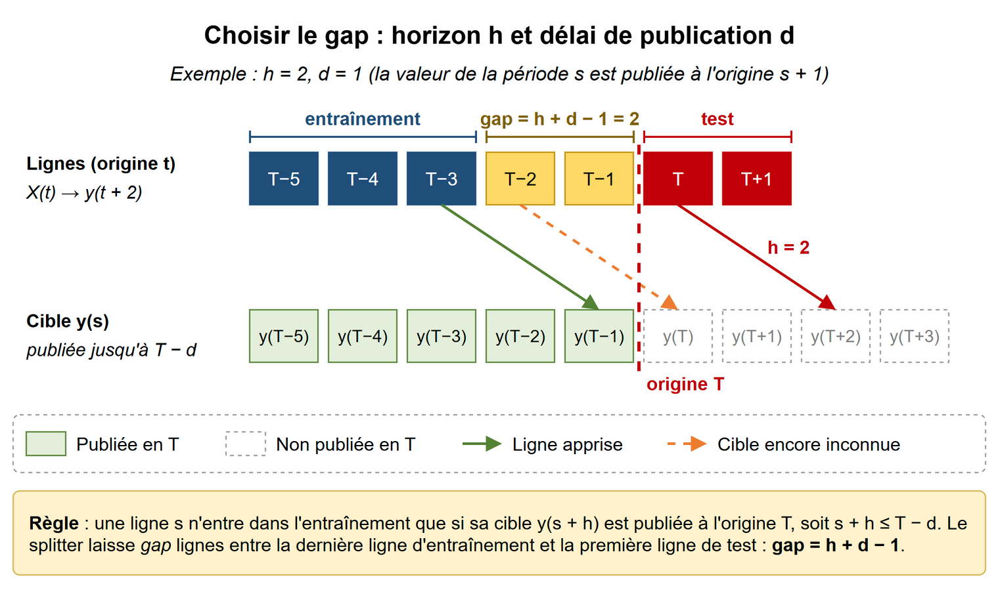

# Tutoriel : ensembles d'entraînement et de test en pseudo temps réel

Ce tutoriel évalue un modèle de prévision comme s'il avait tourné en production : à chaque pli, le
modèle n'apprend que sur ce qui était connu à la date de la prévision. Il construit le jeu
de données, déduit le `gap` de l'horizon et du délai de publication de la cible, puis découpe une
série temporelle et un panel avec les splitters de `tsforecast.crossvals`.

Le [concept](../concepts/cross_validation.md) présente les deux familles de découpage (hors
échantillon, dans l'échantillon) et les variantes de panel.

## Table des matières

- [1. Données](#1-donnees)
- [2. Le jeu de données d'apprentissage](#2-le-jeu-de-donnees-dapprentissage)
- [3. Choisir le `gap`](#3-choisir-le-gap)
- [4. Découper une série : `TSOutOfSampleSplit`](#4-decouper-une-serie-tsoutofsamplesplit)
- [5. Évaluer un modèle](#5-evaluer-un-modele)
- [6. Dans l'échantillon : `TSInSampleSplit`](#6-dans-lechantillon-tsinsamplesplit)
- [7. Panel : `PanelOutOfSampleSplit` et `PanelOutOfSampleSplitPerEntity`](#7-panel-paneloutofsamplesplit-et-paneloutofsamplesplitperentity)
- [8. Erreurs fréquentes](#8-erreurs-frequentes)

## 1. Données

Une production mensuelle (`production`) suit, avec trois mois de retard, un indicateur de climat
des affaires (`climat`), sur dix ans :

```python
import numpy as np
import pandas as pd

rng = np.random.default_rng(0)
dates = pd.date_range("2015-01-01", "2024-12-01", freq="MS", name="date")
t = np.arange(len(dates) + 3)
climate = np.sin(2 * np.pi * t / 30) + rng.normal(0, 0.2, len(t))
data = pd.DataFrame({
    "climat": climate[3:],
    "production": 100 + 0.1 * t[3:] + 3 * climate[:-3] + rng.normal(0, 0.5, len(dates)),
}, index=dates)
```

## 2. Le jeu de données d'apprentissage

Deux grandeurs fixent ce qu'un modèle peut connaître dans un contexte d'apprentissage supervisé :

- l'**horizon** `h` : à l'**origine** `t`, date à laquelle la prévision est faite, on prévoit la
  valeur de la période `t + h` (`h = 0` : estimation de la période en cours) ;
- le **délai de publication** `d` de la cible : la valeur de la période `s` n'est connue qu'à partir
  de l'origine `s + d`. Un indice mensuel publié le 15 du mois suivant a `d = 1` pour des
  prévisions faites le 20 de chaque mois, `d = 2` pour des prévisions faites le 10.

Le jeu de données d'entraînement associe à chaque origine `t` les covariables connues en `t` et la cible
`y(t + h)`. Ici, `h = 2` et `d = 1` :

```python
h, d = 2, 1
supervised = pd.DataFrame({
    "climat": data["climat"],
    "climat_lag1": data["climat"].shift(1),
    "production_publiee": data["production"].shift(d),   # dernière valeur publiée en t
    "cible": data["production"].shift(-h),               # valeur à prévoir, y(t + h)
}).dropna()
X, y = supervised.drop(columns="cible"), supervised["cible"]
len(X), X.index[0], X.index[-1]
# (117, Timestamp('2015-02-01 00:00:00'), Timestamp('2024-10-01 00:00:00'))
```

- **`shift` décale des lignes**, non des dates : la série doit être régulière (un mois par ligne,
  sans trou).
- **Les covariables sont celles connues à l'origine** : la production entre dans `X` décalée de
  `d` mois. Les délais des covariables se traitent en amont avec
  [`PublicationDelayTransformer`](publication_delays.md#6-evaluer-un-modele-avec-delais).

## 3. Choisir le `gap`

À l'origine `T` (première ligne de test d'un pli), une ligne `s` ne peut servir à l'entraînement
que si sa cible `y(s + h)` est publiée, soit `s + h ≤ T − d`. Le splitter laisse `gap` lignes entre
la dernière ligne d'entraînement et `T` ; l'écart minimal sans fuite est donc :

$$\text{gap} = h + d - 1$$



La fonction `leaks` vérifie la règle pli par pli :

```python
from tsforecast.crossvals import TSOutOfSampleSplit

def leaks(splitter, X, h, d):
    """Pour chaque pli : le modèle apprend-il une cible encore inconnue à la première origine de test ?"""
    origins = X.index.to_period("M")
    return [origins[train].max() + h > origins[test].min() - d for train, test in splitter.split(X)]

for gap in range(4):
    print(gap, leaks(TSOutOfSampleSplit(n_splits=4, test_size=6, gap=gap), X, h, d))
# 0 [True, True, True, True]
# 1 [True, True, True, True]
# 2 [False, False, False, False]
# 3 [False, False, False, False]
```

En deçà de `h + d − 1`, chaque pli apprend des cibles encore inconnues à la date de la prévision et
ses scores sont optimistes ; au-delà, le découpage retire des lignes d'entraînement sans nécessité.

## 4. Découper une série : `TSOutOfSampleSplit`

Sans `test_indices`, le splitter produit `n_splits` tests adjacents de `test_size` lignes, le
dernier se terminant à la dernière ligne ; l'entraînement va de la première ligne au test, moins
`gap` lignes :

```python
cv = TSOutOfSampleSplit(n_splits=4, test_size=6, gap=h + d - 1)
for train, test in cv.split(X):
    print(f"entraînement {X.index[train[0]]:%Y-%m} → {X.index[train[-1]]:%Y-%m}"
          f" | test {X.index[test[0]]:%Y-%m} → {X.index[test[-1]]:%Y-%m}")
# entraînement 2015-02 → 2022-08 | test 2022-11 → 2023-04
# entraînement 2015-02 → 2023-02 | test 2023-05 → 2023-10
# entraînement 2015-02 → 2023-08 | test 2023-11 → 2024-04
# entraînement 2015-02 → 2024-02 | test 2024-05 → 2024-10
```

`max_train_size` remplace la fenêtre extensible par une fenêtre glissante, pour un modèle qui
oublie le passé lointain :

```python
cv_rolling = TSOutOfSampleSplit(n_splits=4, test_size=6, gap=h + d - 1, max_train_size=36)
[len(train) for train, _ in cv_rolling.split(X)]
# [36, 36, 36, 36]
```

`test_indices` place les tests sur des épisodes choisis : chaque élément ouvre un pli de
`test_size` lignes, et `get_n_splits()` vaut leur nombre.

```python
cv_dates = TSOutOfSampleSplit(test_indices=["2020-01-01", "2022-07-01"], test_size=12, gap=h + d - 1)
for train, test in cv_dates.split(X):
    print(f"entraînement → {X.index[train[-1]]:%Y-%m} | test {X.index[test[0]]:%Y-%m} → {X.index[test[-1]]:%Y-%m}")
# entraînement → 2019-10 | test 2020-01 → 2020-12
# entraînement → 2022-04 | test 2022-07 → 2023-06
```

<!-- doc-args: tsforecast.crossvals.TSOutOfSampleSplit -->
| Argument | Type | Description |
|----------|------|-------------|
| `n_splits` | `int` | Nombre de plis sans `test_indices` (au moins 2, défaut 5). |
| `test_indices` | positions, dates ou `None` | Débuts de test explicites, chacun ouvrant un pli : positions entières, ou dates (chaînes, `Timestamp`, `datetime`, `date`, `numpy.datetime64`, `Period`) recherchées dans l'index. Une chaîne partielle (`'2024-05'`) doit désigner une seule ligne. Une valeur seule vaut un début. |
| `max_train_size` | `int` ou `None` | Nombre maximal de lignes d'entraînement (fenêtre glissante) ; `None` (défaut) : fenêtre extensible depuis la première ligne. |
| `test_size` | `int` ou `None` | Nombre de lignes de chaque test. Par défaut, `n_samples // (n_splits + 1)`, ou 1 avec `test_indices` ; un test est coupé à la fin des données. |
| `gap` | `int` | Nombre de lignes retirées entre l'entraînement et le test (défaut 0) : `h + d − 1` (section 3). |
<!-- /doc-args -->

Référence complète : [API `TSOutOfSampleSplit`](../api/crossvals/TSOutOfSampleSplit.md).

Un pli qui n'aurait aucune ligne d'entraînement lève une `ValueError`. `split` renvoie les
positions des lignes de `X` tel qu'il est passé : un index non trié est trié en interne, avec un
avertissement, et `X.iloc[train]` reste correct.

## 5. Évaluer un modèle

Le splitter se passe en `cv` aux fonctions de scikit-learn :

```python
from sklearn.linear_model import Ridge
from sklearn.model_selection import cross_validate

scores = cross_validate(Ridge(), X, y, cv=cv, scoring="neg_mean_absolute_error")
(-scores["test_score"]).round(3)
# array([1.724, 0.918, 1.15 , 2.665])
```

Un pli de `test_size` lignes simule un modèle réentraîné toutes les `test_size` périodes : les
origines suivantes du test sont prévues sans les données publiées depuis la première. Pour simuler
un réentraînement mensuel sur les deux dernières années, un pli d'une ligne par mois :

```python
monthly = TSOutOfSampleSplit(n_splits=24, test_size=1, gap=h + d - 1)
scores = cross_validate(Ridge(), X, y, cv=monthly, scoring="neg_mean_absolute_error")
print(f"MAE moyenne : {-scores['test_score'].mean():.3f}")
# MAE moyenne : 1.605
```

## 6. Dans l'échantillon : `TSInSampleSplit`

`TSInSampleSplit` produit un seul pli dont l'entraînement **contient** la période de test et
s'arrête à sa dernière ligne. Il mesure la qualité d'un ajustement historique (rétropolation,
estimation révisée d'une période passée), jamais une erreur de prévision. Sur les mêmes douze
dernières origines, une forêt aléatoire évaluée hors échantillon puis dans l'échantillon :

```python
from sklearn.ensemble import RandomForestRegressor
from tsforecast.crossvals import TSInSampleSplit

first_test = X.index[-12]
for name, splitter in {
    "hors échantillon": TSOutOfSampleSplit(test_indices=first_test, test_size=12, gap=h + d - 1),
    "dans l'échantillon": TSInSampleSplit(test_indices=first_test, test_size=12),
}.items():
    scores = cross_validate(RandomForestRegressor(random_state=0), X, y, cv=splitter,
                            scoring="neg_mean_absolute_error")
    print(f"{name:>18} : MAE = {-scores['test_score'][0]:.3f}")
#   hors échantillon : MAE = 2.058
# dans l'échantillon : MAE = 0.541
```

L'écart mesure ce que le modèle a mémorisé de la période de test.

<!-- doc-args: tsforecast.crossvals.TSInSampleSplit -->
| Argument | Type | Description |
|----------|------|-------------|
| `n_splits` | `int` | Fixe seulement la taille de test par défaut, `n_samples // (n_splits + 1)` (au moins 2, défaut 5) ; le découpage a toujours un seul pli. |
| `test_indices` | positions, dates ou `None` | Lignes de test : un élément ouvre `test_size` lignes à partir de lui ; plusieurs éléments désignent exactement leurs lignes, `test_size` n'étant alors pas utilisé. `None` (défaut) : les dernières lignes. |
| `max_train_size` | `int` ou `None` | Nombre maximal de lignes d'entraînement, porté au besoin à l'étendue du test pour que toute ligne de test soit apprise ; `None` (défaut) : tout l'historique. |
| `test_size` | `int` ou `None` | Nombre de lignes de la période de test (voir `n_splits` et `test_indices` pour les valeurs par défaut). |
<!-- /doc-args -->

Référence complète : [API `TSInSampleSplit`](../api/crossvals/TSInSampleSplit.md).

## 7. Panel : `PanelOutOfSampleSplit` et `PanelOutOfSampleSplitPerEntity`

Le panel porte la même relation pour trois pays aux couvertures différentes : `DE` s'arrête en
septembre 2024, `IT` commence en 2017. Le jeu supervisé se construit **entité par entité** : un
`shift` sur tout le panel ferait passer la cible d'une entité dans la ligne d'une autre.

```python
spans = {"FR": ("2015-01-01", "2024-12-01"), "DE": ("2015-01-01", "2024-09-01"),
         "IT": ("2017-01-01", "2024-12-01")}
frames = {}
for seed, (entity, (start, end)) in enumerate(spans.items()):
    rng = np.random.default_rng(seed)
    idx = pd.date_range(start, end, freq="MS", name="date")
    t = np.arange(len(idx) + 3)
    climate = np.sin(2 * np.pi * t / 30) + rng.normal(0, 0.2, len(t))
    frames[entity] = pd.DataFrame({
        "climat": climate[3:],
        "production": 100 + 0.1 * t[3:] + 3 * climate[:-3] + rng.normal(0, 0.5, len(idx)),
    }, index=idx)
panel = pd.concat(frames, names=["entity"])        # MultiIndex (entity, date)

by_entity = panel.groupby(level="entity")
panel_supervised = pd.DataFrame({
    "climat": panel["climat"],
    "climat_lag1": by_entity["climat"].shift(1),
    "production_publiee": by_entity["production"].shift(d),
    "cible": by_entity["production"].shift(-h),
}).dropna()
X_panel, y_panel = panel_supervised.drop(columns="cible"), panel_supervised["cible"]
```

### 7.1 Dates de test communes : `PanelOutOfSampleSplit`

Les mêmes dates de test valent pour toutes les entités, et chaque pli les contient toutes : un
modèle qui mutualise les entités n'apprend jamais sur la période de test d'une autre. Les entités
sont lues dans l'index (`groups` est facultatif) :

```python
from tsforecast.crossvals import PanelOutOfSampleSplit

cv_panel = PanelOutOfSampleSplit(n_splits=4, test_size=3, gap=h + d - 1)
scores = cross_validate(Ridge(), X_panel, y_panel, cv=cv_panel, scoring="neg_mean_absolute_error")
# UserWarning: Cannot find test period '2024-08-01 00:00:00' for entity 'DE'; the entity is not tested in this fold
(-scores["test_score"]).round(3)
# array([1.41 , 1.498, 1.866, 2.424])
```

Les tests couvrent les douze dernières origines du panel, de novembre 2023 à octobre 2024. La
dernière origine de `DE` est juillet 2024 : au dernier pli (août à octobre), `DE` n'est pas testée,
mais reste dans l'entraînement, sur ses origines antérieures au test moins le `gap`.

<!-- doc-args: tsforecast.crossvals.PanelOutOfSampleSplit -->
| Argument | Type | Description |
|----------|------|-------------|
| `n_splits` | `int` | Nombre de plis sans `test_indices` (au moins 2, défaut 5) : les derniers blocs de `test_size` dates du panel. |
| `test_indices` | dates, couples, positions ou `None` | Débuts de test explicites. Une date ouvre un pli pour chaque entité qui la porte ; un couple `(entité, date)` ou une position entière ouvre un pli limité à son entité. |
| `max_train_size` | `int` ou `None` | Nombre maximal de dates d'entraînement par entité ; `None` (défaut) : fenêtre extensible. |
| `test_size` | `int` ou `None` | Nombre de dates de test par entité et par pli (défaut 1), coupé à la fin de chaque entité. |
| `gap` | `int` | Nombre de dates retirées, dans chaque entité, entre l'entraînement et le test (défaut 0). |
<!-- /doc-args -->

Référence complète : [API `PanelOutOfSampleSplit`](../api/crossvals/PanelOutOfSampleSplit.md).

### 7.2 Dates propres à chaque entité : `PanelOutOfSampleSplitPerEntity`

Chaque entité est découpée sur ses propres dernières dates, avec un pli par entité et par
découpage : `DE` est testée sur ses douze dernières origines. Les arguments sont ceux de
`PanelOutOfSampleSplit` ; le nombre de plis dépend des données, et `get_n_splits` exige `X`.

```python
from tsforecast.crossvals import PanelOutOfSampleSplitPerEntity

cv_entity = PanelOutOfSampleSplitPerEntity(n_splits=4, test_size=3, gap=h + d - 1)
cv_entity.get_n_splits(X_panel)
# 12

scores = cross_validate(Ridge(), X_panel, y_panel, cv=cv_entity, scoring="neg_mean_absolute_error")
entities = [X_panel.index[test[0]][0] for _, test in cv_entity.split(X_panel)]
pd.Series(-scores["test_score"], index=entities).groupby(level=0, sort=False).mean().round(3)
# FR    1.919
# DE    1.111
# IT    2.263
# dtype: float64
```

Les plis viennent découpage par découpage, puis entité par entité : chaque score porte sur une
seule entité. `GridSearchCV` accepte ce splitter tel quel, en lui transmettant les données.

Les variantes dans l'échantillon, `PanelInSampleSplit` et `PanelInSampleSplitPerEntity`, suivent
les règles de `TSInSampleSplit` entité par entité.

## 8. Erreurs fréquentes

| Erreur | Effet | Correction |
|--------|-------|------------|
| `gap=0`, ou `gap=h` en oubliant le délai de la cible | le modèle apprend des cibles non encore publiées : scores optimistes | `gap = h + d − 1` |
| Cible non décalée (`y(t)` sur la ligne `t` alors que l'on prévoit `y(t + h)`) | l'évaluation porte sur un autre horizon | `shift(-h)` de la cible |
| Covariable prise à sa valeur finale (`production` non décalée) | le modèle lit une valeur inconnue à l'origine | décaler de son délai, ou `PublicationDelayTransformer` |
| `shift` sur tout un panel | la cible d'une entité passe dans la ligne d'une autre | `groupby(level="entity").shift(...)` |
| Score dans l'échantillon présenté comme une erreur de prévision | erreur fortement sous-estimée | découpage hors échantillon |

## Voir aussi

- [Concept : cross-validation temporelle](../concepts/cross_validation.md)
- Notebook `notebooks/3 - Crossvals.ipynb`, qui trace les plis de chaque classe
- API : [TSOutOfSampleSplit](../api/crossvals/TSOutOfSampleSplit.md),
  [TSInSampleSplit](../api/crossvals/TSInSampleSplit.md),
  [PanelOutOfSampleSplit](../api/crossvals/PanelOutOfSampleSplit.md),
  [PanelOutOfSampleSplitPerEntity](../api/crossvals/PanelOutOfSampleSplitPerEntity.md)
- [Tutoriel : délais de publication](publication_delays.md), pour les délais des covariables
- [Guide de tracking (MLflow)](../guides/mlflow_tracking.md) : `split_summary`
