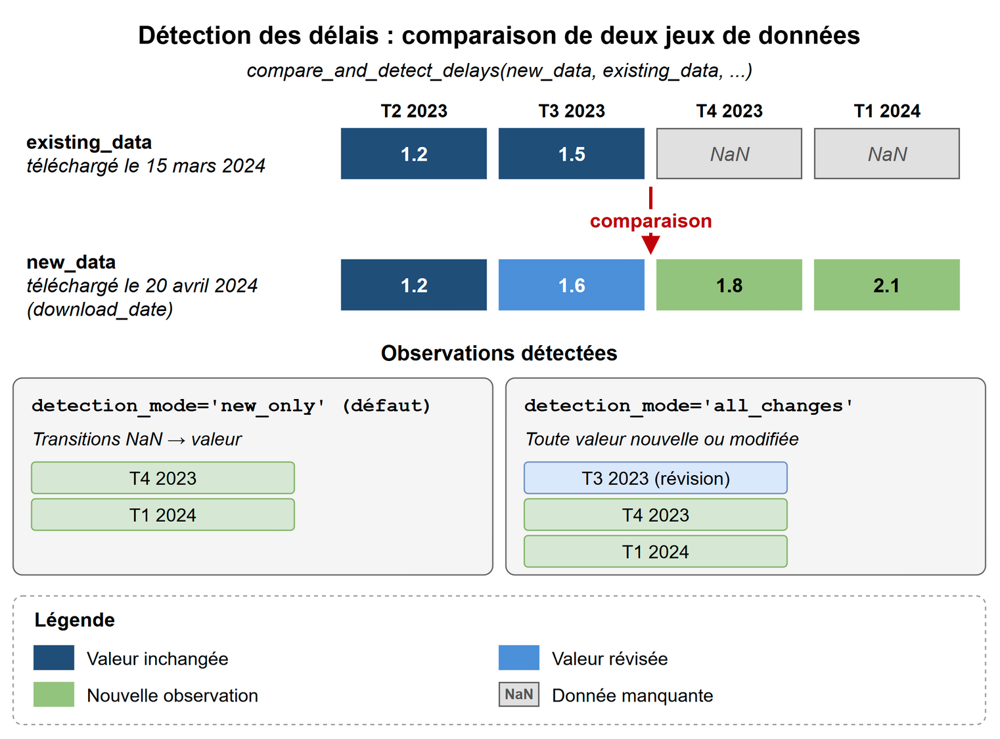
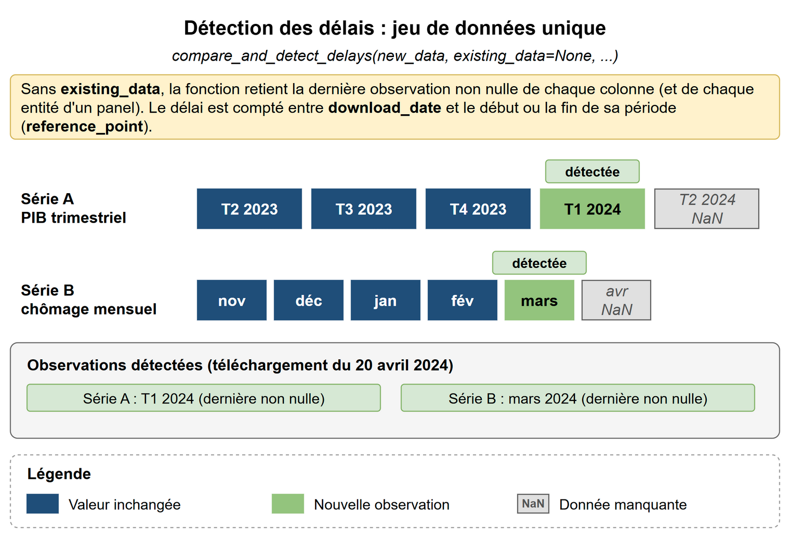
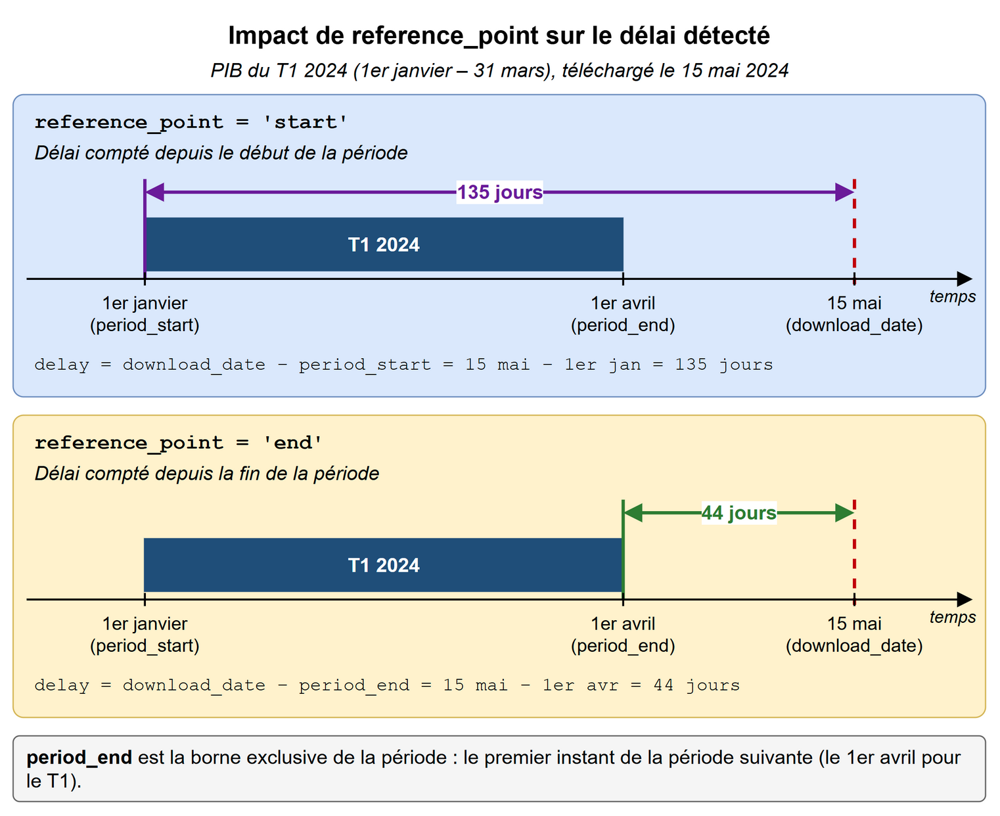
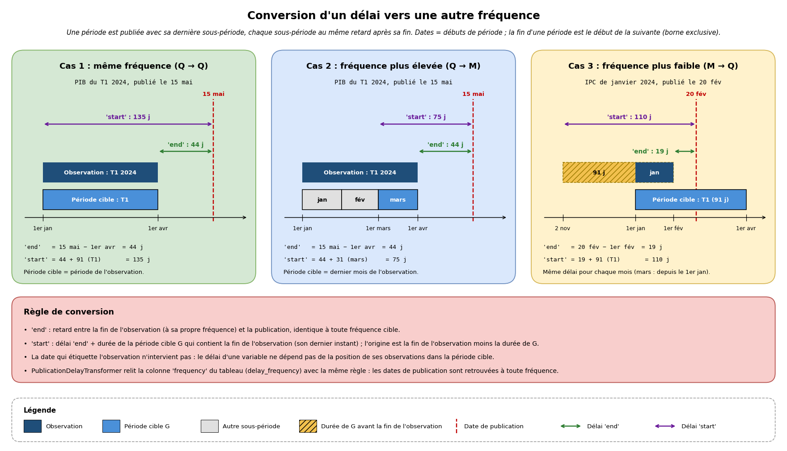
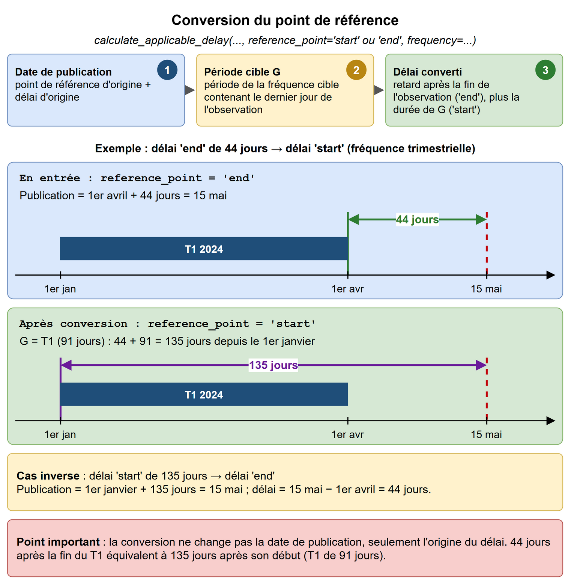
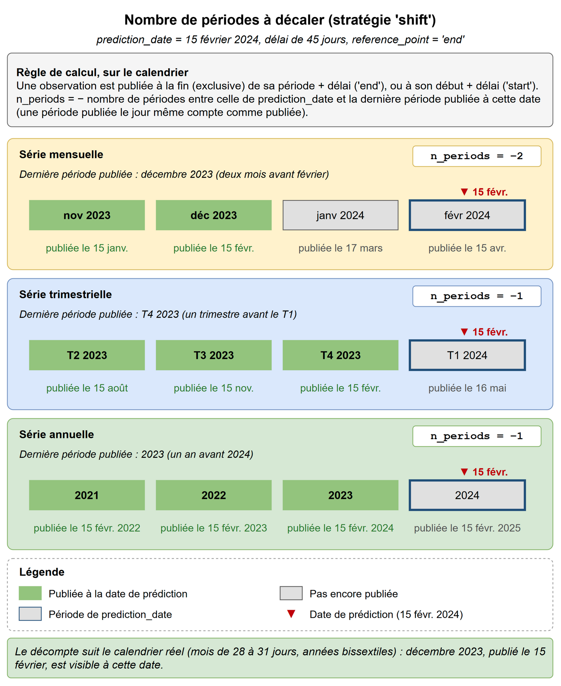
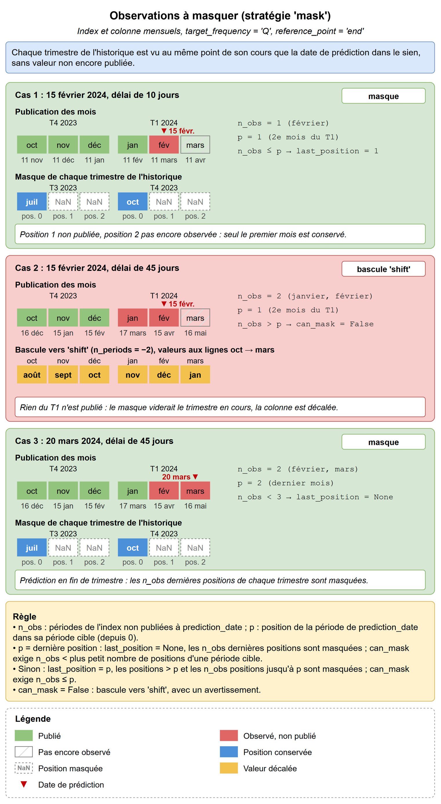

# Tutoriel : délais de publication

Ce tutoriel suit un même jeu de données à travers les trois étapes du module `tsforecast.delays` :
**détecter** les délais de publication à partir de deux extractions datées, les **convertir** en un
délai applicable par variable, puis les **appliquer** pour reconstruire l'information disponible à
une date de prévision. Il se termine par le traitement des panels et par l'évaluation d'un modèle.

Le [concept](../concepts/publication_delays.md) présente le problème adressé par ces classes, le vocabulaire et les notions entourant différents arguments
(`reference_point`, `prediction_date`) et les deux stratégies `mask` et `shift`.

## Table des matières

- [1. Données : deux millésimes](#1-donnees-deux-millesimes)
- [2. Détecter les délais : `compare_and_detect_delays`](#2-detecter-les-delais-compare_and_detect_delays)
- [3. Délais applicables : `calculate_applicable_delay`](#3-delais-applicables-calculate_applicable_delay)
- [4. Appliquer les délais : `PublicationDelayTransformer`](#4-appliquer-les-delais-publicationdelaytransformer)
- [5. Panel : des délais propres à chaque entité](#5-panel-des-delais-propres-a-chaque-entite)
- [6. Évaluer un modèle avec délais](#6-evaluer-un-modele-avec-delais)

## 1. Données : deux millésimes

Un indice de prix mensuel (`cpi`) et un PIB trimestriel (`gdp`), étiquetés au premier jour de leur
période, sont téléchargés deux fois : le 10 mai 2024 (`existing_data`) puis le 16 mai 2024
(`new_data`). Entre les deux, l'indice d'avril et le PIB du premier trimestre ont été publiés, et le
PIB du quatrième trimestre 2023 a été révisé.

```python
import numpy as np
import pandas as pd

dates = pd.date_range("2023-01-01", "2024-04-01", freq="MS", name="date")
new_data = pd.DataFrame(
    {"cpi": np.linspace(100.0, 107.5, len(dates)).round(1), "gdp": np.nan}, index=dates
)
quarters = ["2023-01-01", "2023-04-01", "2023-07-01", "2023-10-01", "2024-01-01"]
new_data.loc[quarters, "gdp"] = [500.0, 503.0, 507.0, 510.0, 514.0]

existing_data = new_data.copy()
existing_data.loc["2024-04-01", "cpi"] = np.nan   # indice d'avril pas encore publié
existing_data.loc["2024-01-01", "gdp"] = np.nan   # PIB du T1 pas encore publié
existing_data.loc["2023-10-01", "gdp"] = 509.0    # PIB du T4 2023 avant révision
```

## 2. Détecter les délais : `compare_and_detect_delays`

### 2.1 Comparer deux millésimes

`compare_and_detect_delays` repère les observations apparues entre les deux extractions et mesure,
pour chacune, le temps écoulé entre sa période et la date de téléchargement du nouveau millésime.



```python
from tsforecast.delays import compare_and_detect_delays

delays = compare_and_detect_delays(
    new_data, existing_data, download_date="2024-05-16", reference_point="end"
)
delays[["observation_date", "frequency", "period_end", "delay", "unit"]]
#        observation_date frequency period_end  delay unit
# column
# cpi          2024-04-01        MS 2024-05-01   15.0  day
# gdp          2024-01-01    QS-JAN 2024-04-01   45.0  day
```

L'indice est publié 15 jours après la fin du mois, le PIB 45 jours après la fin du trimestre. La
précision du délai dépend de l'écart entre les deux millésimes : une observation publiée entre deux
extractions éloignées reçoit la date de la seconde, donc un délai majoré.

Le mode par défaut, `detection_mode='new_only'`, ne retient que les valeurs nouvelles (`NaN` →
valeur). `'all_changes'` retient aussi les révisions :

```python
revisions = compare_and_detect_delays(
    new_data, existing_data, download_date="2024-05-16",
    reference_point="end", detection_mode="all_changes",
)
revisions[["observation_date", "delay"]]
#        observation_date  delay
# column
# cpi          2024-04-01   15.0
# gdp          2023-10-01  136.0
# gdp          2024-01-01   45.0
```

Le délai se compte toujours depuis la période de l'observation : le délai entre la première
publication du T4 2023 et sa révision s'obtient par différence entre les deux résultats.

### 2.2 Un seul millésime

Sans `existing_data`, la fonction retient la dernière observation non nulle de chaque variable :
une seule extraction suffit pour initialiser un suivi des délais, à condition qu'elle soit faite peu
après la dernière publication de chaque variable.



```python
compare_and_detect_delays(new_data, download_date="2024-05-16", reference_point="end")[["delay"]]
#         delay
# column
# cpi      15.0
# gdp      45.0
```

### 2.3 Le point de référence

`reference_point` choisit le point de la période depuis lequel le délai se compte.



| `reference_point` | Formule |
|-------------------|---------|
| `'start'` | `delay = download_date - period_start` |
| `'end'` | `delay = download_date - period_end` (borne exclusive : premier instant de la période suivante) |

```python
compare_and_detect_delays(new_data, download_date="2024-05-16", reference_point="start")[["delay"]]
#         delay
# column
# cpi      45.0     <- 16 mai - 1er avril
# gdp     136.0     <- 16 mai - 1er janvier
```

### 2.4 Arguments

<!-- doc-args: tsforecast.delays.compare_and_detect_delays -->
| Argument | Type | Description |
|----------|------|-------------|
| `new_data` | `pd.DataFrame` | Nouveau jeu de données. L'index porte les dates (ou un `MultiIndex` avec les dates en dernier niveau pour un panel). |
| `existing_data` | `pd.DataFrame` ou `None` | Jeu de données précédent. Si `None`, retient l'observation non nulle la plus récente par variable. |
| `download_date` | `str` ou `datetime` | Date de téléchargement de `new_data` (`'today'` accepté). Si `None`, utilise `datetime.now()`. Une date sans fuseau horaire est lue en UTC face à une date avec fuseau (et réciproquement) ; deux dates avec fuseaux sont comparées comme des instants. |
| `detection_mode` | `'new_only'` ou `'all_changes'` | `'new_only'` (défaut) ne retient que les transitions `NaN` → valeur, `'all_changes'` aussi les révisions. |
| `reference_point` | `'start'` ou `'end'` | Point de la période depuis lequel le délai se compte (défaut `'start'`). |
| `delay_unit` | `str` | Unité du délai retourné : `'day'`/`'D'` (défaut), `'second'`/`'s'` ou `'microsecond'`/`'us'`. |
| `time_col` | `str` ou `None` | Colonne des dates, si elles ne sont pas dans l'index. |
| `panel_cols` | `List[str]` ou `None` | Colonnes des entités d'un panel, si elles ne sont pas dans l'index. |
| `return_report` | `bool` | Argument nommé uniquement. Si `True`, renvoie le tuple `(délais, rapport)`, où le rapport est un `DelayDetectionReport` : colonnes comparées et ignorées, observations nouvelles, révisées et disparues, fréquences détectées, statistiques des délais. Défaut : `False`. |
<!-- /doc-args -->

Référence complète : [API `compare_and_detect_delays`](../api/delays/compare_and_detect_delays.md).

### 2.5 Valeur retournée

Un `DataFrame` indexé par les niveaux d'entité des données (aucun pour une série temporelle) suivis
d'un niveau `column` portant le nom de la variable ; une variable peut figurer sur plusieurs lignes.
Ses colonnes sont, dans l'ordre :

| Colonne | Description |
|---------|-------------|
| `observation_date` | Date de l'observation détectée |
| `has_changes` | Toujours `True` (marque les observations détectées) |
| `download_date` | Date de téléchargement à partir de laquelle est calculé le délai |
| `frequency` | Fréquence détectée du couple (entité, variable), en code pandas complet avec position, ancrage et multiplicateur (`'D'`, `'W-WED'`, `'MS'`, `'QE-DEC'`, `'2MS'`, ...) ; les ancrages équivalents sont écrits comme pandas les canonise (trimestres finissant en novembre : `'QE-FEB'`). Manquante (`NaN`) si elle est indétectable (une seule observation) : un avertissement est alors émis et `period_start`, `period_end` et `delay` valent `NaT` / `NaN` |
| `period_start` | Début de la période de l'observation à la fréquence détectée. L'ancrage fixe les périodes (les semaines `'W-WED'` vont du jeudi au mercredi, les trimestres `'QS-MAR'` commencent en mars, juin, septembre et décembre). Une période multipliée est celle de la grille des données : elle commence à la date d'observation pour une fréquence de début de période ou sans position (`'2MS'`, `'3D'`), elle finit avec la période de la date pour une fréquence de fin de période ou hebdomadaire (`'2ME'`, `'2W-SUN'`) |
| `period_end` | Borne de fin **exclusive** de la période (premier instant de la période suivante : `2023-05-01` pour avril) |
| `reference_point` | Point de référence utilisé (`'start'` ou `'end'`) |
| `delay` | Délai entre le point de référence et la date de téléchargement, arrondi à l'entier supérieur de l'unité ; négatif si le téléchargement précède ce point (une prévision utilisée comme observation) |
| `unit` | Unité du délai (`'day'`, `'second'`, `'microsecond'`) |

Les quatre colonnes de dates sont stockées dans l'unité des dates de `new_data` (`s`, `ms`, `us` ou
`ns`), quelles que soient celles de `existing_data` et de `download_date` ; une date que cette unité
ne représente pas exactement (une heure de téléchargement à la microseconde sur des données en
secondes) porte sa colonne à une unité plus fine, sans arrondi. Les colonnes de texte (`frequency`,
`reference_point`, `unit`) sont en dtype `str` ; le niveau `column` porte les noms des variables dans
le dtype que pandas en infère. Un résultat vide a les mêmes dtypes qu'un résultat non vide.

!!! warning "Les étiquettes fixent l'ancrage des périodes"
    La fréquence est celle que pandas lit sur les dates de chaque couple (entité, variable),
    ancrage compris : les bornes de période suivent la convention de pandas pour cet ancrage,
    et non le calendrier par défaut. La position d'une étiquette mensuelle ne change rien
    (`2023-04-01` et `2023-04-30` désignent tous deux avril), mais l'emplacement d'une valeur
    de plus basse fréquence en change la période :

    | Étiquettes | Fréquence lue | Période de la dernière étiquette |
    |------------|---------------|----------------------------------|
    | hebdomadaire, le lundi (`2023-11-20`) | `'W-MON'` | du mardi 14 au lundi 20 novembre |
    | trimestrielle, au 1er du dernier mois (`2023-12-01`) | `'QS-MAR'` | de décembre à février |
    | trimestrielle, au dernier jour du premier mois (`2023-10-31`) | `'QE-JAN'` | d'août à octobre |
    | annuelle, au 1er décembre (`2023-12-01`) | `'YS-DEC'` | de décembre 2023 à novembre 2024 |

    Pour obtenir des périodes calendaires, étiquetez chaque valeur par le premier jour de sa
    période (`'QS'`, `'YS'` : le 1er du premier mois) ou par son dernier jour (`'QE'`, `'YE'` :
    le dernier jour du dernier mois ; une semaine du lundi au dimanche : le dimanche, `'W-SUN'`).
    `calculate_applicable_delay` et `PublicationDelayTransformer` lisent les mêmes périodes.

Le rapport de détection (`return_report=True`) et sa traduction en métriques sont décrits dans le
[guide de tracking](../guides/mlflow_tracking.md).

## 3. Délais applicables : `calculate_applicable_delay`

### 3.1 Un délai par variable

`compare_and_detect_delays` renvoie un délai par observation détectée.
`calculate_applicable_delay` les exprime à une fréquence et un point de référence choisis, puis les
agrège (médiane par défaut) en un délai par variable :

```python
from tsforecast.delays import calculate_applicable_delay

applicable = calculate_applicable_delay(
    delays, reference_point="end", frequency={"cpi": "M", "gdp": "Q"}
)
applicable
#         delay unit frequency reference_point  n_observations aggregation_method
# column
# cpi      15.0  day         M             end               1             median
# gdp      45.0  day         Q             end               1             median
```

Ce tableau se passe tel quel à `PublicationDelayTransformer` (section 4).

### 3.2 La règle de conversion

La conversion repose sur une règle unique : **une période est publiée avec sa dernière
sous-période, chaque sous-période étant publiée au même retard après sa fin** (les mois d'un
trimestre forment le trimestre).

- **Depuis la fin** (`reference_point='end'`), le délai est le retard entre la fin de la période de
  l'observation (à sa propre fréquence, borne exclusive) et la publication, **quelle que soit la
  fréquence cible**.
- **Depuis le début** (`'start'`), le délai ajoute la durée de la période cible qui contient le
  dernier jour de l'observation : le **dernier mois** pour une observation trimestrielle ramenée au
  mois, le trimestre pour une observation mensuelle ramenée au trimestre.



```python
calculate_applicable_delay(delays, reference_point="start", frequency="M")[["delay", "frequency"]]
#         delay frequency
# column
# cpi      45.0         M     <- 15 jours + avril (30 jours)
# gdp      76.0         M     <- 45 jours + mars (31 jours)

calculate_applicable_delay(delays, reference_point="start", frequency="Q")[["delay", "frequency"]]
#         delay frequency
# column
# cpi     106.0         Q     <- 15 jours + T2 (91 jours)
# gdp     136.0         Q     <- 45 jours + T1 2024 (91 jours)
```

La conversion d'un point de référence à l'autre se fait en trois temps : reconstruction de la date
de publication à partir du délai d'origine, choix de la période cible contenant le dernier jour de
l'observation, puis calcul du délai depuis le point de référence cible.



La date qui étiquette l'observation (début ou fin de période) n'intervient pas, et le délai d'une
variable ne dépend pas de la position de ses observations dans la période cible : l'agrégation de
plusieurs observations garde un sens. `PublicationDelayTransformer` relit la colonne `frequency` du
résultat comme la fréquence à laquelle les délais sont exprimés (`delay_frequency`) et applique la
même règle : un délai converti à n'importe quelle fréquence redonne les mêmes dates de publication.

### 3.3 Arguments

<!-- doc-args: tsforecast.delays.calculate_applicable_delay -->
| Argument | Type | Description |
|----------|------|-------------|
| `publication_delays` | `pd.DataFrame` | Résultat de `compare_and_detect_delays()`. |
| `reference_point` | `'start'` ou `'end'` | Point de référence cible (la fin est la borne exclusive). |
| `frequency` | `str` ou `Dict` | Fréquence cible (`'M'`, `'Q'`, `'QE-NOV'`, `'W-WED'`, `'monthly'`, etc.) ou dictionnaire : clés = indicateurs (`{'gdp': 'M'}`) et/ou couples complets de l'index `(entité, ..., indicateur)` (`{('FR', 'gdp'): 'M'}`), la clé du couple l'emportant sur celle de l'indicateur. Chaque ligne doit être couverte. Le code pandas est lu en entier : son ancrage fixe les périodes cibles (`'QE-NOV'` : trimestres de septembre à novembre), sa position ne les change pas (`'M'`, `'MS'` et `'ME'` désignent les mêmes mois). Une fréquence multipliée (`'2MS'`) n'a de périodes que sur la grille des données : elle n'est acceptée que comme fréquence de l'observation elle-même. Sans `aggregate_by_panel`, les entités d'un indicateur doivent partager les mêmes périodes cibles (`'QE-NOV'` et `'QS-DEC'` sont la même cible, `'Q'` et `'QE-NOV'` non). |
| `unit` | `str` ou `None` | Unité cible (toute durée : `'D'`, `'h'`, `'W'`, `'s'`, ...), arrondie au supérieur. Si `None`, unité des données d'entrée (les lignes agrégées ensemble doivent alors en partager une). |
| `indicators` | `List[str]` ou `None` | Indicateurs à traiter. Si `None`, tous. |
| `aggregate_by_panel` | `bool` | Si `True`, un délai par entité et par indicateur (section 5). Sinon, agrégation sur toutes les entités. |
| `aggregation_method` | `str` ou `callable` | `'mean'`, `'median'` (défaut), `'max'`, `'min'`, ou fonction personnalisée. Un nom inconnu lève une `ValueError`. |
<!-- /doc-args -->

Référence complète : [API `calculate_applicable_delay`](../api/delays/calculate_applicable_delay.md).

### 3.4 Valeur retournée

Un `DataFrame` indexé par indicateur (par entité et indicateur sous `aggregate_by_panel=True`) :

| Colonne | Description |
|---------|-------------|
| `delay` | Délai après conversion et agrégation |
| `unit` | Unité du délai (son code, `'D'`, si `unit` est fourni) |
| `frequency` | Fréquence cible, telle que passée en argument ; relue par `PublicationDelayTransformer` |
| `reference_point` | Point de référence cible |
| `n_observations` | Nombre d'observations de délai connu utilisées dans l'agrégation |
| `aggregation_method` | Méthode d'agrégation utilisée |

Une ligne dont le délai est `NaN` ou la fréquence manquante (couple à fréquence indétectable) est
**conservée avec un délai `NaN`** : elle n'est pas comptée dans `n_observations`, et un groupe
composé uniquement de telles lignes a un délai `NaN` et `n_observations=0`.

## 4. Appliquer les délais : `PublicationDelayTransformer`

### 4.1 Stratégie `shift`

On se place au **20 mai 2024** : l'indice d'avril (publié le 16 mai) et le PIB du T1 (publié le
16 mai) sont connus. La stratégie `shift` décale chaque série pour que la ligne d'une date porte la
dernière valeur publiée à cette date :

```python
from tsforecast.delays import PublicationDelayTransformer

shift = PublicationDelayTransformer(
    delays=applicable, strategy="shift", prediction_date="2024-05-20"
)
shifted = shift.fit_transform(new_data)

shift.shift_params
# {'cpi': {'n_periods': -1, 'frequency': 'MS'}, 'gdp': {'n_periods': -1, 'frequency': 'QS-JAN'}}
shifted.loc["2024-01-01":"2024-05-01"]
#               cpi    gdp
# date
# 2024-01-01  105.5  510.0
# 2024-02-01  106.0    NaN
# 2024-03-01  106.5    NaN
# 2024-04-01  107.0  514.0
# 2024-05-01  107.5    NaN
```

Chaque ligne porte l'indice du mois précédent (celle de mai, l'indice d'avril) et la ligne d'avril
porte le PIB du T1. L'unité, le point de référence
et la fréquence des délais sont lus dans le tableau ; avec un dictionnaire de délais, ils se passent
au constructeur (section 4.8). La transformation est réversible :

```python
shift.inverse_transform(shifted).equals(new_data)
# True
```

### 4.2 Stratégie `mask`

La stratégie `mask` laisse les dates en place et reproduit, dans **chaque** période cible de
l'historique, l'information disponible au même point de la période de `prediction_date`. Le 20 mai
est dans le deuxième mois du T2 : avec `target_frequency='Q'`, chaque trimestre est vu à son
deuxième mois, où seul son premier mois est publié.

```python
mask = PublicationDelayTransformer(
    delays=applicable, strategy="mask", prediction_date="2024-05-20", target_frequency="Q"
)
masked = mask.fit_transform(new_data)
# UserWarning: Could not mask the column 'gdp' because it would have created a series of Nan.
#   Moved it to the shifted columns

mask.mask_params
# {'cpi': {'n_obs': 1, 'mask_frequency': 'Q', 'how': 'last', 'last_position': 1}}
mask.shift_params
# {'gdp': {'n_periods': -1, 'frequency': 'QS-JAN'}}
masked.loc["2023-10-01":"2024-05-01"]
#               cpi    gdp
# date
# 2023-10-01  104.5  507.0
# 2023-11-01    NaN    NaN
# 2023-12-01    NaN    NaN
# 2024-01-01  106.0  510.0
# 2024-02-01    NaN    NaN
# 2024-03-01    NaN    NaN
# 2024-04-01  107.5  514.0
# 2024-05-01    NaN    NaN
```

Rien du PIB du T2 n'est publié au 20 mai : le masque viderait chaque trimestre, si bien que la
colonne bascule vers le décalage, avec un avertissement. Le rapport d'ajustement résume ces choix :

```python
print(mask.fit_report_.summary())
# delays fit (prediction_date=2024-05-20): 1 shifted, 1 masked, 0 unaffected, 0 ignored,
#   0 defaults imputed, 1 mask fallbacks
```

### 4.3 Arguments

<!-- doc-args: tsforecast.delays.PublicationDelayTransformer -->
| Argument | Type | Description |
|----------|------|-------------|
| `delays` | `Dict` ou `pd.DataFrame` | Délais par variable. Si `DataFrame` : une ligne par variable, colonne `'delay'`, variable dans une colonne `'column'` ou dans l'index (niveau `'column'`, à défaut le dernier) — la sortie de `calculate_applicable_delay` convient telle quelle ; colonnes optionnelles `'unit'`, `'reference_point'`, `'frequency'`. Un délai `NaN` est inconnu. Une variable listée plusieurs fois (délais par entité) est refusée : voir la section 5. |
| `prediction_date` | `str` ou `datetime` | Date à laquelle on se place. `'today'` (défaut) pour la date courante. |
| `strategy` | `str` ou `Dict` | `'shift'` (défaut) ou `'mask'`, globale ou par variable ; une variable retardée absente du dictionnaire est laissée telle quelle (avec un avertissement). |
| `target_frequency` | `str`, `Dict` ou `None` | Fréquence des périodes de la stratégie `'mask'`, dont l'ancrage fixe les périodes masquées (`'QE-NOV'` : trimestres de septembre à novembre). Si `None`, lue dans la colonne `frequency` du tableau, puis dans `default_values`. Ignorée pour `'shift'`. |
| `delay_unit` | `str`, `Dict` ou `None` | Unité des délais, globale ou par variable. Si `None`, lue dans le tableau, puis dans `default_values`. Une colonne retardée sans unité lève une `ValueError`. |
| `reference_point` | `str`, `Dict` ou `None` | Point de référence des délais (`'start'` / `'end'`), global ou par variable. Si `None`, lu dans le tableau, puis dans `default_values`. |
| `handle_missing_delays` | `str` | Variables de `X` sans délai connu (laissées telles quelles) : `'warn'` (défaut) les signale, `'error'` lève une `ValueError`, `'ignore'` se tait. |
| `default_values` | `Dict` ou `None` | Valeurs par défaut des colonnes de `X` qui en manquent : clés `'delay'`, `'unit'`, `'reference_point'` (et `'target_frequency'` pour `'mask'`). Avec lui, toutes les colonnes de `X` reçoivent un délai. Ignoré avec une stratégie par variable. |
| `delay_frequency` | `str`, `Dict` ou `None` | Fréquence à laquelle les délais sont exprimés, globale ou par variable. Si `None`, lue dans la colonne `frequency` du tableau, sinon fréquence de la colonne. Un délai `'end'` est le retard après la fin de chaque observation, à toute fréquence ; un délai `'start'` se compte depuis la fin de l'observation moins la période de `delay_frequency` qui contient son dernier jour (règle de la section 3.2). Une fréquence multipliée (`'2MS'`) n'est acceptée que si c'est celle de la colonne. |
<!-- /doc-args -->

Référence complète : [API `PublicationDelayTransformer`](../api/delays/PublicationDelayTransformer.md).

### 4.4 Attributs après `fit`

| Attribut | Description |
|----------|-------------|
| `prediction_date_` | Date de prédiction résolue (objet `datetime`) |
| `detected_frequencies_` | Fréquence détectée de chaque colonne, en code pandas complet (`'MS'`, `'W-WED'`, `'QE-FEB'`, `'2MS'`) : son ancrage fixe les périodes comptées par le décalage et le masque |
| `grid_origins_` | Début d'une période de la grille des données de chaque colonne à fréquence multipliée (`None` pour les autres) : une colonne `'2MS'` observée en février, avril, ... compte des périodes février-mars, avril-mai, ..., et non des périodes alignées sur l'epoch. Pour un panel, les entités doivent partager cette grille |
| `delay_frequencies_` | Fréquence, en code pandas complet, à laquelle le délai de chaque colonne est lu |
| `shift_params` | Paramètres de décalage par colonne : `{'n_periods': int, 'frequency': str}` |
| `mask_params` | Paramètres de masquage par colonne (ceux de `MaskTransformer`) : `{'n_obs': int, 'mask_frequency': str, 'how': str, 'last_position': int ou None}` |
| `fit_report_` | `DelayFitReport` : paramétrage résolu de chaque colonne et son origine (explicite, inféré, par défaut) |
| `auxiliary_transformers_` | Transformeurs auxiliaires du dernier `transform`, utilisés par `inverse_transform` (qui exige donc un `transform` préalable) |

### 4.5 Index, aller-retour et cible

Le décalage déplace les dates sans perdre de valeur : l'index de sortie est l'union des dates
décalées des colonnes (il s'allonge, et les dates qu'aucune colonne n'occupe plus disparaissent),
trié par date (pour un panel : par entité, dans l'ordre d'entrée, puis par date).
`inverse_transform` supprime les lignes ajoutées par `transform`, si bien que
`inverse_transform(transform(X))` restitue `X` à l'identique.

Seul `X` est transformé : sous `'shift'`, les lignes de `X` ne correspondent plus à celles de `y`.
La section 6 montre comment l'enchaîner avec un modèle.

### 4.6 Calcul du nombre de périodes à décaler (`'shift'`)

Le calcul se fait **sur le calendrier** : l'observation de la période commençant en *s* est publiée
en *s + délai* (point de référence `'start'`) ou à la fin (exclusive) de sa période + délai
(`'end'`). `n_periods` vaut moins le nombre de périodes entre la période de `prediction_date` et la
**dernière période publiée à `prediction_date`** (une période publiée le jour même compte comme
publiée). La durée réelle des mois (28 à 31 jours) et les années bissextiles sont prises en compte ;
le délai, lui, est une durée (un délai en mois compte 30 jours par mois, comme partout dans le
package).



Avec un délai de 45 jours depuis la fin (`'end'`) et une prédiction au 15 février 2024 :

| Fréquence | Dernière période publiée au 15 février 2024 | `n_periods` |
|-----------|---------------------------------------------|-------------|
| Mensuel (M) | Décembre 2023 (fin 1er janv. + 45 j = 15 févr. ; janvier : 17 mars) | -2 |
| Trimestriel (Q) | T4 2023 (fin 1er janv. + 45 j = 15 févr.) | -1 |
| Annuel (Y) | 2023 (fin 1er janv. + 45 j = 15 févr.) | -1 |

Dans l'exemple de la section 4.1, au 20 mai, l'indice d'avril et le PIB du T1, publiés le 16 mai,
sont les dernières périodes publiées : un mois et un trimestre de recul. Au 15 mai, ils ne
l'auraient pas encore été et chaque série reculerait de deux périodes.

### 4.7 Calcul du nombre d'observations à masquer (`'mask'`)

La stratégie `'mask'` compte de la même façon, sur le calendrier, les **périodes de l'index** (pas
celles de la série) non encore publiées à `prediction_date` (`n_obs`). Elle situe ensuite la période
de l'index de `prediction_date` dans sa période cible (position `p`, comptée depuis 0) :

- **prédiction dans la dernière période de l'index de sa période cible** (mars pour un trimestre,
  31 mars pour un mois) : chaque période cible est vue à sa fin, ses `n_obs` dernières positions
  sont masquées (`last_position=None`) ;
- **prédiction en cours de période cible** : chaque période cible est coupée à la position `p`
  (`last_position=p`) ; les positions postérieures (pas encore observées) et les `n_obs` positions
  qui précèdent jusqu'à `p` incluse (pas encore publiées) sont masquées. Les positions se comptent
  depuis le début de la période : au 15 mars, chaque mois est vu comme à son 15.



**Faisabilité.** Le masque doit laisser au moins une observation dans chaque période cible :

- prédiction en fin de période : `n_obs` est comparé au plus petit nombre de périodes de l'index
  dans une période cible couverte par les données, compté sur le calendrier (28 jours en
  février 2023, 3 mois par trimestre) ;
- prédiction en cours de période : au moins la première position doit être publiée (`n_obs <= p`).

Sinon, rien de la période cible de `prediction_date` n'est encore publié : la colonne bascule vers
la stratégie `'shift'` avec un avertissement, comme le PIB de la section 4.2.

Exemples (index et colonne mensuels, cible `'Q'`, `'end'`) :

| Prédiction | Délai | Publié | `n_obs` | Résultat |
|------------|-------|--------|---------|----------|
| 15 février 2024 (position 1) | 10 jours | janvier (11 févr.), pas février | 1 | `last_position=1` : seul le premier mois de chaque trimestre est conservé |
| 15 février 2024 (position 1) | 45 jours | décembre (15 févr.), pas janvier (17 mars) | 2 > `p` | bascule vers `'shift'` (`n_periods=-2`) |
| 20 mars 2024 (position 2) | 45 jours | janvier (17 mars), pas février (15 avril) | 2 | `last_position=None` : les deux derniers mois de chaque trimestre sont masqués |

### 4.8 Délais saisis à la main, stratégies mixtes

Les délais peuvent aussi être donnés par un dictionnaire ; l'unité et le point de référence se
passent alors au constructeur (ou par `default_values`), et la stratégie peut changer d'une variable
à l'autre :

```python
daily = pd.DataFrame(
    {"sales": np.arange(100.0), "traffic": np.arange(100.0)},
    index=pd.date_range("2024-01-01", periods=100, freq="D", name="date"),
)
mixed = PublicationDelayTransformer(
    delays={"sales": 3, "traffic": 10},
    strategy={"sales": "shift", "traffic": "mask"},
    prediction_date="2024-03-15",
    delay_unit="D",
    reference_point="end",
    target_frequency="M",
)
daily_delayed = mixed.fit_transform(daily)
mixed.shift_params
# {'sales': {'n_periods': -4, 'frequency': 'D'}}
mixed.mask_params
# {'traffic': {'n_obs': 11, 'mask_frequency': 'M', 'how': 'last', 'last_position': 14}}
```

Au 15 mars, les ventes sont connues jusqu'au 11 mars (quatre jours de recul) et le trafic jusqu'au
4 mars : chaque mois est vu comme à son 15, où seuls ses quatre premiers jours sont publiés.

## 5. Panel : des délais propres à chaque entité

Passé directement à un `PublicationDelayTransformer`, un panel reçoit **les mêmes délais** pour
toutes les entités (un avertissement le rappelle). Pour des délais propres à chaque entité, on les
calcule par entité (`aggregate_by_panel=True`) puis on confie un transformeur à chaque entité par
[`PanelwiseTransformer`](../concepts/panelwise_transforms.md).

Dans le panel ci-dessous, l'Allemagne publie son indice de prix 30 jours plus tard que la France :

```python
from tsforecast.delays import create_delay_transformer_factory
from tsforecast.panel import PanelwiseTransformer

germany = 1.1 * new_data
germany.loc["2024-04-01", "cpi"] = np.nan   # indice d'avril pas encore publié
panel = pd.concat({"FR": new_data, "DE": germany}, names=["country", "date"])

panel_delays = compare_and_detect_delays(panel, download_date="2024-05-16", reference_point="end")
panel_applicable = calculate_applicable_delay(
    panel_delays, reference_point="end",
    frequency={"cpi": "M", "gdp": "Q"}, aggregate_by_panel=True,
)
panel_applicable[["delay", "frequency"]]
#                 delay frequency
# country column
# DE      cpi      45.0         M
#         gdp      45.0         Q
# FR      cpi      15.0         M
#         gdp      45.0         Q

factory = create_delay_transformer_factory(
    panel_applicable, strategy="shift", prediction_date="2024-05-20"
)
panel_shifted = PanelwiseTransformer(transformer=factory).fit_transform(panel)
panel_shifted.loc[(slice(None), "2024-05-01"), :]
#                     cpi  gdp
# country date
# FR      2024-05-01  107.5  NaN
# DE      2024-05-01  117.7  NaN
```

Au 20 mai, la ligne de mai porte l'indice d'avril pour la France, celui de mars pour l'Allemagne.

`prepare_entity_kwargs_from_delays(panel_applicable, strategy=...)` produit les mêmes paramètres
sous forme de dictionnaire `{entité: kwargs}`, à passer en `entity_kwargs` d'un
`PanelwiseTransformer`.

`calculate_applicable_delay` accepte aussi une fréquence cible par couple (entité, indicateur) :
`frequency={('DE', 'gdp'): 'M', 'gdp': 'Q', 'cpi': 'M'}`. Sans `aggregate_by_panel`, les entités
d'un même indicateur doivent partager la même fréquence cible (leurs délais sont agrégés ensemble) ;
sinon une `ValueError` demande d'agréger par entité.

## 6. Évaluer un modèle avec délais

Entraîner et évaluer un modèle sur les données « telles qu'elles existent aujourd'hui » lui donne
accès à des valeurs qu'il n'aurait pas eues en temps réel, et surestime ses performances. Les délais
s'appliquent donc à `X` **avant** la validation croisée, une seule fois :

```python
from sklearn.impute import SimpleImputer
from sklearn.linear_model import Ridge
from sklearn.model_selection import cross_validate
from sklearn.pipeline import make_pipeline
from tsforecast.crossvals import TSOutOfSampleSplit

y = pd.Series(np.linspace(1.0, 2.5, len(new_data)), index=new_data.index, name="target")

X_delayed = (
    PublicationDelayTransformer(delays=applicable, strategy="shift", prediction_date="2024-05-20")
    .fit_transform(new_data)
    .reindex(new_data.index)   # retour aux lignes de y
)
scores = cross_validate(
    make_pipeline(SimpleImputer(), Ridge()), X_delayed, y,
    cv=TSOutOfSampleSplit(n_splits=3, test_size=2), scoring="neg_mean_absolute_error",
)
```

- **Pourquoi une seule fois ?** Le décalage et le masque ne dépendent que des délais et de la
  position de `prediction_date` dans sa période, jamais de la cible ni du découpage : les appliquer
  en amont de la validation croisée n'introduit aucune fuite, et chaque pli voit chaque ligne telle
  qu'elle était connue au même point de sa période.
- **Quelle `prediction_date` ?** Elle représente la position, dans sa période, des prévisions que
  l'on évalue (au 20 du mois, l'indice du mois précédent est publié ; au 10, il ne l'est pas).
  Laissée à `'today'`, elle rend le résultat dépendant du jour d'exécution.
- **`.reindex(new_data.index)`** ramène `X` aux lignes de `y` : sous `'shift'`, l'index s'allonge
  et les premières périodes, pas encore publiées, restent vides (`SimpleImputer` les comble).
  `PublicationDelayTransformer` n'est pas une étape XY ; le
  [concept du pipeline XY](../concepts/xy_pipeline.md) détaille ce point.
- **Délai de la cible.** Les délais traités ici sont ceux des covariables. Celui de la cible se
  traite par l'écart entre entraînement et test (`gap`) du splitter : voir le tutoriel
  [Ensembles train/test rigoureux](pseudo_real_time_forecast.md).
- **Données multi-fréquences.** Avec un [`HighFrequencyImputer`](mixed_frequency_imputation.md),
  les délais s'appliquent avant l'imputeur, qui ne répartit alors entre les sous-périodes que des totaux déjà publiés.

## Voir aussi

- [Concept : délais de publication](../concepts/publication_delays.md), qui décrit aussi les
  briques bas niveau `ShiftTransformer` et `MaskTransformer` et les rapports de détection et
  d'ajustement
- API : [PublicationDelayTransformer](../api/delays/PublicationDelayTransformer.md),
  [compare_and_detect_delays](../api/delays/compare_and_detect_delays.md),
  [calculate_applicable_delay](../api/delays/calculate_applicable_delay.md),
  [rapports](../api/delays/report.md)
- [Guide de tracking (MLflow)](../guides/mlflow_tracking.md) : `delay_metrics`, `detection_metrics`
