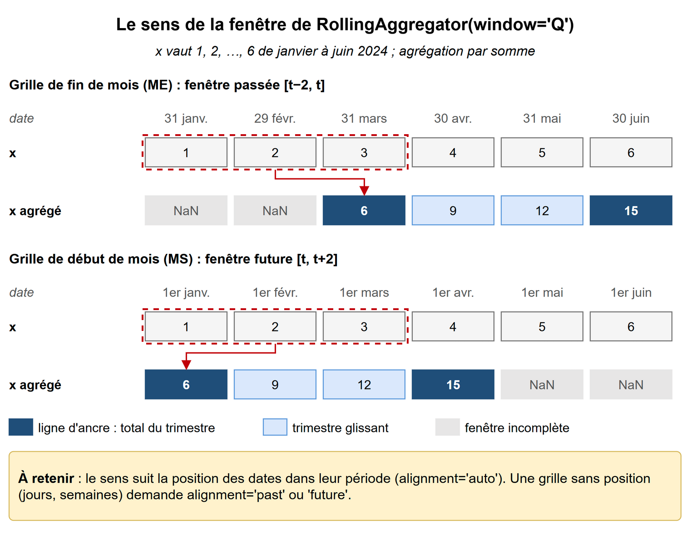

# Tutoriel : extensions de scikit-learn

Ce tutoriel applique, sur un même panel mensuel, les classes qui adaptent scikit-learn aux séries
temporelles et aux panels. Il illustre comment écrire un transformateur temporel validé, ajuster un transformateur par
entité, transformer la cible dans un pipeline, retirer les lignes sans cible, agréger sur une période
glissante, puis valider le pipeline obtenu. Le [concept](../concepts/sklearn_extensions.md) énonce
les règles que ces classes appliquent.

## Table des matières

- [1. Données](#1-donnees)
- [2. Écrire un transformateur temporel : `PanelTimeSeriesTransformer`](#2-ecrire-un-transformateur-temporel-paneltimeseriestransformer)
- [3. Ajuster un transformateur par entité : `PanelwiseTransformer`](#3-ajuster-un-transformateur-par-entite-panelwisetransformer)
- [4. Transformer la cible : `XYPipeline`](#4-transformer-la-cible-xypipeline)
- [5. Retirer les lignes sans cible : `DropNaNTarget`](#5-retirer-les-lignes-sans-cible-dropnantarget)
- [6. Agréger sur une période glissante : `RollingAggregator`](#6-agreger-sur-une-periode-glissante-rollingaggregator)
- [7. Valider le pipeline](#7-valider-le-pipeline)

## 1. Données

Un panel mensuel de deux pays, indexé par `(country, date)`, de janvier 2023 à décembre 2024 : un
indice de production (`production`, trois fois plus élevé en Allemagne), un solde d'opinion
(`confidence`) et la cible, les ventes du mois en milliards d'euros (`sales`). Les ventes, de même
niveau dans les deux pays, suivent avec un mois de retard l'écart de la production à sa moyenne
propre, et l'opinion. Deux observations de ventes manquent.

```python
import numpy as np
import pandas as pd

rng = np.random.default_rng(0)
production = np.array([[1.0], [3.0]]) * (100 + rng.normal(0, 1, (2, 25)).cumsum(axis=1))
confidence = rng.normal(0, 5, (2, 25))
gap = (production - production.mean(axis=1, keepdims=True)) / production.std(axis=1, keepdims=True)
sales = 50 + 2 * gap[:, :-1] + 0.2 * confidence[:, :-1] + rng.normal(0, 0.5, (2, 24))

dates = pd.date_range("2023-01-31", periods=24, freq="ME", name="date")
index = pd.MultiIndex.from_product([["FR", "DE"], dates], names=["country", "date"])
X = pd.DataFrame(
    {"production": production[:, 1:].ravel(), "confidence": confidence[:, 1:].ravel()}, index=index
)
y = pd.Series(sales.ravel(), index=index, name="sales")
y[[("FR", "2023-06-30"), ("DE", "2024-02-29")]] = np.nan
```

## 2. Écrire un transformateur temporel : `PanelTimeSeriesTransformer`

Une sous-classe de `PanelTimeSeriesTransformer` n'écrit que `_fit` et `_transform`. Les méthodes
publiques `fit` et `transform` valident les données avant de les lui passer, et enregistrent les
attributs de la convention sklearn.

```python
from tsforecast.base import PanelTimeSeriesTransformer


class Center(PanelTimeSeriesTransformer):
    """Centre chaque colonne sur sa moyenne d'entraînement."""

    def _fit(self, X, y=None):
        self.mean_ = X.mean()

    def _transform(self, X):
        return X - self.mean_


center = Center().fit(X)
center.is_panel_, center.n_features_in_, list(center.feature_names_in_)
# (True, 2, ['production', 'confidence'])
center.transform(X).groupby(level="country").mean().round(1)
#          production  confidence
# country
# DE            100.6        -0.1
# FR           -100.6         0.1
```

La même classe accepte une série (`X.loc["FR"]`) comme un panel. La moyenne apprise est commune aux
deux pays : chacun reste décalé de sa moyenne propre. La [section 3](#3-ajuster-un-transformateur-par-entite-panelwisetransformer)
apprend une moyenne par pays.

La validation lève une `ValueError` pour :

- une entrée qui n'est pas un `DataFrame` (une série se passe sous la forme `series.to_frame()`) ;
- des étiquettes temporelles qui ne sont pas des dates : un `RangeIndex` ou des années entières sont
  refusés, des chaînes de dates et des `Period` sont lues comme des dates ;
- au `transform`, des colonnes différentes de celles vues au `fit`, ou dans un autre ordre.

Elle refuse aussi un couple (entité, date) répété, des dates non triées et des entités dont les
lignes ne sont pas contiguës ; sous `strict_validation=False`, ces trois défauts ne donnent qu'un
avertissement (un doublon garde sa première occurrence). `auto_sort=True` trie une copie :

```python
shuffled = X.sample(frac=1, random_state=0)
Center(auto_sort=True).fit_transform(shuffled).index.get_level_values("country").unique().tolist()
# ['DE', 'FR']
```

Sur un `DataFrame` plat, `time_col` et `panel_cols` nomment les colonnes de dates et d'entités.
Par défaut, elles restent des colonnes et `_fit` les reçoit parmi les autres ;
`convert_cols_to_index=True` les passe dans l'index avant l'appel :

```python
flat = X.reset_index()
flat.columns.tolist()
# ['country', 'date', 'production', 'confidence']
Center(time_col="date", panel_cols=["country"], convert_cols_to_index=True).fit_transform(flat).index.names
# FrozenList(['country', 'date'])
```

### 2.1 Réversibilité : `ReversibleTransformerMixin` et `InverseTransformer`

`ReversibleTransformerMixin` rend `inverse_transform` obligatoire et fournit
`_restore_structure_if_converted`, qui remet les colonnes passées dans l'index à leur place
d'origine (et les `Period` d'un index de périodes).

```python
from tsforecast.base import InverseTransformer, ReversibleTransformerMixin


class ReversibleCenter(Center, ReversibleTransformerMixin):
    def inverse_transform(self, X):
        return self._restore_structure_if_converted(X + self.mean_)


flat_center = ReversibleCenter(time_col="date", panel_cols=["country"], convert_cols_to_index=True)
centered = flat_center.fit_transform(flat)
restored = flat_center.inverse_transform(centered)
restored.columns.tolist(), np.allclose(restored["production"], flat["production"])
# (['country', 'date', 'production', 'confidence'], True)
```

`InverseTransformer` enveloppe un transformateur **déjà ajusté** et échange `transform` et
`inverse_transform`. C'est une étape pré-ajustée : son `fit` ne fait rien et `clone` la rend
telle quelle, si bien qu'elle garde son ajustement dans `cross_validate` ou `GridSearchCV`.

```python
undo = InverseTransformer(flat_center)
undo.transform(centered).equals(restored)
# True
```

### 2.2 Arguments

<!-- doc-args: tsforecast.base.PanelTimeSeriesTransformer -->
| Argument | Type | Description |
|----------|------|-------------|
| `time_col` | `str` ou `None` | Colonne des dates d'un `DataFrame` plat. Si `None` (défaut), les dates sont dans l'index (dernier niveau d'un `MultiIndex`). |
| `panel_cols` | `List[str]` ou `None` | Colonnes des entités d'un `DataFrame` plat ; exige `time_col`. Si `None`, les entités sont les premiers niveaux d'un `MultiIndex`. |
| `validate_input` | `bool` | Valide les données au `fit` et au `transform` (défaut `True`). |
| `strict_validation` | `bool` | Si `True` (défaut), un défaut lève une `ValueError` ; si `False`, un avertissement. |
| `auto_sort` | `bool` | Trie une copie par entité puis par date (défaut `False`). |
| `convert_cols_to_index` | `bool` | Passe `time_col` et `panel_cols` dans l'index avant `_fit` et `_transform` (défaut `False`). |
<!-- /doc-args -->

Après `fit` : `is_panel_`, `n_features_in_`, `feature_names_in_` et, sous
`convert_cols_to_index=True`, `conversion_metadata_`. Référence complète :
[API des transformateurs de base](../api/base/transformers.md).

## 3. Ajuster un transformateur par entité : `PanelwiseTransformer`

`PanelwiseTransformer` clone un transformateur sklearn pour chaque entité et ajuste chaque clone sur
les seules lignes de son entité.

```python
from sklearn.preprocessing import StandardScaler
from tsforecast.panel import PanelwiseTransformer

scaler = PanelwiseTransformer(StandardScaler())
X_scaled = scaler.fit_transform(X)
X_scaled.groupby(level="country").mean().abs().round(2)
#          production  confidence
# country
# DE              0.0         0.0
# FR              0.0         0.0
list(scaler.transformers_), scaler.get_entity_transformer("DE").mean_.round(1).tolist()
# ([('FR',), ('DE',)], [299.7, 0.2])
```

Les clés d'entité sont des tuples ; `get_entity_transformer` accepte aussi la valeur seule (`"DE"`).
La sortie garde l'index, les colonnes et l'ordre des lignes de l'entrée.

Toute opération qui lit les lignes voisines (variation, décalage, moyenne mobile) doit être appliquée
par entité. Appliquée au panel entier, la première ligne d'un pays lit la dernière du précédent :

```python
from sklearn.preprocessing import FunctionTransformer

growth = FunctionTransformer(lambda df: df.pct_change(), feature_names_out="one-to-one")
X[["production"]].pct_change().loc["DE"].head(2).round(3)
#             production
# date
# 2023-01-31       2.036
# 2023-02-28      -0.009
PanelwiseTransformer(growth).fit_transform(X[["production"]]).loc["DE"].head(2).round(3)
#             production
# date
# 2023-01-31         NaN
# 2023-02-28      -0.009
```

### 3.1 Un paramétrage par entité

Deux modes donnent à chaque entité ses propres paramètres : une **fabrique**, appelée avec la clé de
l'entité, ou `entity_kwargs`, appliqués par `set_params` au clone de l'entité
(`default_entity_kwargs` couvre les entités qu'il ne nomme pas).

```python
factory = PanelwiseTransformer(lambda key: StandardScaler(with_std=key != ("FR",)))
per_entity = PanelwiseTransformer(StandardScaler(), entity_kwargs={"FR": {"with_std": False}})
factory.fit_transform(X).equals(per_entity.fit_transform(X))
# True
```

### 3.2 Panel en colonnes, entités nouvelles, inversion

Sur un `DataFrame` plat, `panel_cols` nomme les colonnes d'entités et `time_col` (défaut `'date'`)
celle des dates ; ces colonnes sont rendues inchangées.

```python
PanelwiseTransformer(StandardScaler(), panel_cols=["country"]).fit_transform(flat).columns.tolist()
# ['country', 'date', 'production', 'confidence']
```

Une entité absente du `fit` suit `error_handling` : `'raise'` (défaut) lève une `ValueError`,
`'warn'` et `'ignore'` rendent ses lignes inchangées, avec ou sans avertissement. La même règle
s'applique à un clone qui échoue ; les entités en échec au `fit` sont listées dans
`failed_entities_`.

```python
import warnings

italy = X.loc[["FR"]].rename(index={"FR": "IT"})
with warnings.catch_warnings(record=True) as caught:
    warnings.simplefilter("always")
    unchanged = scaler.set_params(error_handling="warn").transform(italy)
str(caught[0].message), unchanged.equals(italy)
# ("Entity ('IT',) was not seen during fit. Using untransformed data.", True)
```

`inverse_transform` inverse chaque entité par son propre clone, si le transformateur de base est
réversible :

```python
np.allclose(scaler.inverse_transform(X_scaled), X)
# True
```

### 3.3 Arguments

<!-- doc-args: tsforecast.panel.PanelwiseTransformer -->
**Transformateur**

| Argument | Type | Description |
|----------|------|-------------|
| `transformer` | estimateur sklearn, ou `Callable[[tuple], estimateur]` | Transformateur (ou pipeline) cloné pour chaque entité, ou fabrique appelée avec la clé de l'entité. |
| `entity_kwargs` | `dict` ou `None` | `{entité: paramètres}` appliqués par `set_params` au clone de l'entité. Une clé scalaire désigne une entité à un niveau (`'FR'` vaut `('FR',)`). Ignoré, avec un avertissement, sous une fabrique. |
| `default_entity_kwargs` | `dict` ou `None` | Paramètres des entités absentes d'`entity_kwargs`. |

**Structure des données**

| Argument | Type | Description |
|----------|------|-------------|
| `time_col` | `str` | Colonne des dates d'un `DataFrame` plat (défaut `'date'`). Absente des colonnes d'un `MultiIndex`, les dates sont lues sur le dernier niveau. |
| `panel_cols` | `List[str]` ou `None` | Colonnes des entités d'un `DataFrame` plat. Inutile avec un `MultiIndex`. |
| `convert_cols_to_index` | `bool` | Passe `time_col` et `panel_cols` dans l'index (défaut `False`). |

**Validation et exécution**

| Argument | Type | Description |
|----------|------|-------------|
| `validate_input` | `bool` | Valide les données (défaut `True`). |
| `strict_validation` | `bool` | Erreur (défaut `True`) ou avertissement sur un défaut de validation. |
| `auto_sort` | `bool` | Trie une copie par entité puis par date (défaut `False`). |
| `n_jobs` | `int` | Nombre de processus de l'ajustement (joblib, `-1` : tous) ; la transformation reste séquentielle (défaut `1`). |
| `error_handling` | `'raise'`, `'warn'`, `'ignore'` | Entité absente du `fit` ou clone en échec : erreur, avertissement ou silence, les lignes restant inchangées (défaut `'raise'`). |
<!-- /doc-args -->

Après `fit` : `transformers_` (`{entité: clone ajusté}`), `entities_` (nombre d'entités),
`transform_columns_`, `failed_entities_`, `is_factory_mode_`. Référence complète :
[API `PanelwiseTransformer`](../api/panel/PanelwiseTransformer.md).

## 4. Transformer la cible : `XYPipeline`

Un `Pipeline` de sklearn ne transforme que `X` : la cible arrive intacte à l'estimateur, et une
étape qui rendrait la paire `(X, y)` la passerait tout entière, comme `X`, à l'étape suivante. Or,
pour prévoir les ventes du mois suivant, chaque ligne de `X` doit être associée à la cible **un mois
plus tard**, pays par pays. Une **étape XY** fait ce travail : elle hérite de `XYTransformerMixin`,
écrit `_fit` et `_transform`, et rend la paire `(X, y)` quand elle reçoit une cible et `X` seul sinon.

```python
from sklearn.base import BaseEstimator
from tsforecast.xy import XYTransformerMixin


class TargetLead(BaseEstimator, XYTransformerMixin):
    """Associe à chaque ligne la cible `horizon` mois plus tard, pays par pays."""

    def __init__(self, horizon=1):
        self.horizon = horizon

    def _fit(self, X, y):
        return self

    def _transform(self, X, y=None):
        if y is None:
            return X
        return X, y.groupby(level="country").shift(-self.horizon)
```

`XYPipeline` donne la cible aux étapes XY et lit leur sortie comme la paire `(X, y)` ; il traite les
autres étapes exactement comme `Pipeline`, `transform(X)` sans la cible. `DropNaNTarget` retire
ensuite les lignes sans cible (section 5).

```python
from sklearn.linear_model import Ridge
from tsforecast.xy import DropNaNTarget, XYPipeline, is_xy_transformer

pipe = XYPipeline([
    ("lead", TargetLead(horizon=1)),                    # étape XY
    ("scale", PanelwiseTransformer(StandardScaler())),  # étape ordinaire : X seul
    ("drop", DropNaNTarget()),                          # étape XY
    ("model", Ridge()),
])
[is_xy_transformer(step) for _, step in pipe.steps]
# [True, False, True, False]
X_train, y_train = pipe[:-1].fit_transform(X, y)
X_train.shape, y_train.notna().all()
# ((44, 2), True)
pipe.fit(X, y).predict(X).shape
# (48,)
```

À l'entraînement, chaque pays perd sa dernière ligne (cible future inconnue) et la ligne qui précède
chaque vente manquante : 44 lignes sur 48. À la prédiction, aucune étape ne reçoit la cible :
`predict` rend une prévision par ligne de `X`, celle du 31 décembre 2024 visant janvier 2025. Les
méthodes de prédiction (`predict`, `predict_proba`, `decision_function`...) refusent un argument `y`
par une `TypeError` ; `score(X, y)` évalue le pipeline.

Une étape est XY **par déclaration** : elle hérite de `XYTransformerMixin` ou de
`XYPanelTimeSeriesTransformer` (qui ajoute la validation de la section 2), jamais en raison de sa
signature. Une étape XY qui reçoit `y` et rend autre chose qu'une paire lève une `TypeError`.
`inverse_transform` parcourt les étapes en ordre inverse et inverse `y` dans les étapes XY qui
l'implémentent (`_inverse_transform`).

### 4.1 Arguments

<!-- doc-args: tsforecast.xy.XYPipeline -->
| Argument | Type | Description |
|----------|------|-------------|
| `steps` | liste de `(nom, estimateur)` | Étapes, comme pour `Pipeline` ; la dernière peut être tout estimateur. |
| `transform_input` | liste de `str` ou `None` | Métadonnées transformées par les étapes précédentes avant d'atteindre une étape (exige le *metadata routing*). |
| `memory` | `str`, `joblib.Memory` ou `None` | Cache de l'ajustement des étapes intermédiaires, étapes XY comprises (défaut `None`). |
| `verbose` | `bool` | Affiche la durée d'ajustement de chaque étape (défaut `False`). |
| `preserve_dataframe` | `bool` | Rend la structure pandas à une sortie en tableau d'une entrée pandas, pour `fit_transform` et `transform` (défaut `True`). |
<!-- /doc-args -->

Référence complète : [API `XYPipeline`](../api/xy/XYPipeline.md),
[`XYTransformerMixin`](../api/xy/XYTransformerMixin.md).

## 5. Retirer les lignes sans cible : `DropNaNTarget`

`DropNaNTarget`, placée juste avant l'estimateur, retire les lignes dont la cible manque quand elle
reçoit `y` (`fit`, `score`) et n'en retire aucune sans `y` (`predict`). Elle n'a pas de paramètre.

```python
round(pipe.score(X, y), 3)
# 0.936
```

Un paramètre d'ajustement qui compte une valeur par ligne de `X`, comme `sample_weight`, suit les
lignes gardées : l'estimateur reçoit les 44 poids de ses 44 lignes d'entraînement.

```python
weights = np.where(X.index.get_level_values("date").year == 2024, 2.0, 1.0)
pipe.fit(X, y, model__sample_weight=weights).named_steps["model"].coef_.round(2)
# array([1.8 , 0.92])
```

Les lignes gardées sont localisées sur l'index de `y` (sinon de `X`) : il faut un index pandas sans
doublon. Sur des tableaux numpy dont une étape XY change le nombre de lignes, un paramètre par
ligne est refusé par une `ValueError`.

## 6. Agréger sur une période glissante : `RollingAggregator`

`RollingAggregator` remplace chaque colonne par son agrégat sur une **période calendaire
glissante**, pays par pays : sur une grille mensuelle, `window="Q"` fait de chaque mois un
**trimestre glissant**. C'est une étape XY à deux passes :

- `fit_transform(X, y)` (entraînement) agrège `X` et `y` (`target_agg`, somme par défaut) ;
- `transform(X, y)` (prédiction, `score`) agrège `X` seul et rend `y` inchangé.

```python
from tsforecast.xy import RollingAggregator

roll = RollingAggregator(window="Q", agg="mean")
X_q, y_q = roll.fit_transform(X, y)
roll.grid_frequencies_, roll.window_lengths_, roll.alignments_
# ({('FR',): 'ME', ('DE',): 'ME'}, {('FR',): 3, ('DE',): 3}, {('FR',): 'past', ('DE',): 'past'})
pd.DataFrame({"sales": y, "sales_q": y_q}).loc["FR"].head(4).round(1)
#             sales  sales_q
# date
# 2023-01-31   51.9      NaN
# 2023-02-28   50.4      NaN
# 2023-03-31   51.6    153.9
# 2023-04-30   51.9    154.0
roll.transform(X, y)[1].equals(y)
# True
```

Sur une grille de fin de mois (`ME`), la fenêtre est **passée** (`[t-2, t]`) ; sur une grille de
début de mois (`MS`), elle est **future** (`[t, t+2]`). Dans les deux cas, la ligne d'ancre d'un
trimestre (31 mars, ou 1er janvier) porte le total exact de ce trimestre. Une fenêtre incomplète
(bord des données, valeur manquante, date absente de la grille) donne NaN : ici, les deux premiers
mois de chaque pays et, pour `sales`, les trois trimestres glissants qui contiennent une vente
manquante.



La convention des deux passes sert le cas où la cible d'évaluation est **publiée par trimestre** :
le modèle apprend sur des ventes mensuelles agrégées en trimestres glissants (trois fois plus de
lignes qu'un jeu trimestriel), et `score` compare ses prédictions aux totaux trimestriels tels
qu'ils sont publiés, sur les lignes d'ancre.

```python
from sklearn.impute import SimpleImputer

quarter_end = X.index.get_level_values("date").month % 3 == 0
y_published = y_q.where(quarter_end)            # totaux trimestriels, NaN les autres mois
quarterly = XYPipeline([
    ("scale", PanelwiseTransformer(StandardScaler())),
    ("roll", RollingAggregator(window="Q", agg="mean")),
    ("drop", DropNaNTarget()),
    ("fill", SimpleImputer()),                  # fenêtres incomplètes de X à la prédiction
    ("model", Ridge()),
]).fit(X, y)
predicted = pd.Series(quarterly.predict(X), index=X.index)
pd.DataFrame({"publié": y_published, "prédit": predicted}).loc["FR"].dropna().tail(4).round(1)
#             publié  prédit
# date
# 2024-03-31   148.7   145.6
# 2024-06-30   144.7   144.7
# 2024-09-30   143.0   145.2
# 2024-12-31   147.2   148.8
round(quarterly.score(X, y_published), 3)
# 0.906
```

Seule une agrégation qui reconstruit la quantité publiée suit cette convention. Un logarithme ou un
taux de croissance de la cible s'appliquent aussi à la cible de test : par un
`TransformedTargetRegressor` autour de l'estimateur, jamais à l'entraînement seul.

`agg` accepte un dictionnaire par colonne, avec une clé `'__default__'` ; `suffix` garde les
colonnes d'origine et ajoute les agrégats après elles :

```python
RollingAggregator(window="Q", agg={"production": "sum", "__default__": "mean"}, suffix="_q").fit_transform(X).columns.tolist()
# ['production', 'confidence', 'production_q', 'confidence_q']
```

### 6.1 Arguments

<!-- doc-args: tsforecast.xy.RollingAggregator -->
**Fenêtre et agrégation**

| Argument | Type | Description |
|----------|------|-------------|
| `window` | `str` | Période glissante (`'Q'`, `'Y'`, `'3M'`...). La grille de chaque entité, détectée au `fit`, doit être de même base ou s'y emboîter exactement : `Y` sur `Q`, `M` ou `SM` ; `Q` sur `M` ou `SM` ; `M` sur `SM` ; `W` sur `D`. |
| `agg` | `'sum'`, `'mean'`, `'min'`, `'max'`, `'first'`, `'last'`, ou `dict` | Agrégation des colonnes de `X`, ou `{colonne: agrégation}` avec une clé `'__default__'` facultative (défaut `'sum'`). |
| `target_agg` | même vocabulaire que `agg` | Agrégation de `y` à la passe d'entraînement (défaut `'sum'`). |
| `alignment` | `'auto'`, `'past'`, `'future'` | Sens de la fenêtre ; `'auto'` (défaut) le lit sur la position de la grille, et exige donc une grille de début ou de fin de période. |
| `suffix` | `str` ou `None` | Si `None` (défaut), chaque colonne est remplacée par son agrégat ; sinon les agrégats, suffixés, s'ajoutent aux colonnes d'origine. |

**Structure et validation des données**

| Argument | Type | Description |
|----------|------|-------------|
| `time_col` | `str` ou `None` | Colonne des dates d'un `DataFrame` plat (défaut `None` : index). |
| `panel_cols` | `List[str]` ou `None` | Colonnes des entités d'un `DataFrame` plat ; exige `time_col`. |
| `validate_input` | `bool` | Valide les données (défaut `True`). |
| `strict_validation` | `bool` | Erreur (défaut `True`) ou avertissement sur un défaut de validation. |
| `auto_sort` | `bool` | Trie une copie par entité puis par date (défaut `False`). |
| `convert_cols_to_index` | `bool` | Passe `time_col` et `panel_cols` dans l'index (défaut `False`). |
<!-- /doc-args -->

Après `fit` : `grid_frequencies_`, `window_lengths_`, `alignments_` (par entité, `()` pour une
série) et `aggregations_` (par colonne). Référence complète :
[API `RollingAggregator`](../api/xy/RollingAggregator.md).

## 7. Valider le pipeline

`XYPipeline` est un estimateur sklearn : `GridSearchCV` et `cross_validate` l'ajustent sur chaque
pli. Les ventes d'un mois étant publiées le mois suivant, un horizon `h = 1` et un délai `d = 1`
donnent l'écart minimal sans fuite `gap = h + d − 1 = 1` (voir
[le choix du `gap`](pseudo_real_time_forecast.md#3-choisir-le-gap)).

```python
from sklearn.model_selection import GridSearchCV
from tsforecast.crossvals import PanelOutOfSampleSplit

cv = PanelOutOfSampleSplit(n_splits=3, test_size=3, gap=1)
search = GridSearchCV(pipe, {"model__alpha": [0.1, 10.0, 100.0]}, cv=cv).fit(X, y)
search.best_params_, search.cv_results_["mean_test_score"].round(3)
# ({'model__alpha': 10.0}, array([-0.462,  0.53 ,  0.521]))
```

Le score par défaut (`scoring=None`) est `pipe.score`, qui fait passer la cible de test par
`TargetLead` et `DropNaNTarget`. Un scorer textuel (`scoring="r2"`) compare au contraire
`pipe.predict(X_test)` au `y_test` brut : ni décalé d'un mois, ni débarrassé de ses NaN. Il faut alors
un scorer qui reproduise la transformation de la cible de test.

## Voir aussi

- [Concept : extensions de scikit-learn](../concepts/sklearn_extensions.md)
- Notebook : `notebooks/0 - QB - Sklearn extensions.ipynb`
- [Tutoriel : imputation multi-fréquences](mixed_frequency_imputation.md), qui place
  `HighFrequencyImputer` et `RollingAggregator` dans un même `XYPipeline`
- API : [transformateurs de base](../api/base/transformers.md),
  [PanelwiseTransformer](../api/panel/PanelwiseTransformer.md),
  [XYPipeline](../api/xy/XYPipeline.md), [DropNaNTarget](../api/xy/DropNaNTarget.md),
  [RollingAggregator](../api/xy/RollingAggregator.md)
